# Especificación integral del producto y documentación técnica

## Plataforma web y móvil de fidelización para cafeterías con múltiples sedes

**Documento maestro de análisis, planificación, alcance funcional y especificación técnica**  
**Versión:** 1.0 — Borrador funcional/técnico consolidado  
**Fecha de elaboración:** 6 de noviembre de 2026  
**Idioma:** Español  
**Moneda inicial:** COP (peso colombiano)  
**Estado:** Base de referencia para diseño, estimación, implementación y documentación posterior

---

## Control del documento

| Campo | Detalle |
|---|---|
| Producto | Plataforma digital de fidelización para cafeterías |
| Tipo de solución | Aplicación móvil, aplicación web de clientes, panel administrativo y API central |
| Modelo operativo | Una marca o negocio con múltiples sedes |
| Versión del documento | 1.0 |
| Audiencia | Propietario del negocio, analistas, diseñadores, desarrolladores, QA y responsables de operación |
| Propósito | Mantener en un solo lugar la visión del producto, sus reglas, requisitos, arquitectura, datos, APIs, seguridad y pruebas |
| Estado de aprobación | Pendiente de validación por el propietario del negocio |

### Convenciones utilizadas

- **Definido:** decisión comunicada por el solicitante y adoptada como línea base.
- **Propuesto:** recomendación de diseño que conviene aprobar antes de implementar.
- **Pendiente:** dato comercial, operativo o legal que debe confirmar el negocio.
- **MVP:** primera versión funcional publicable, con alcance controlado.
- **API:** interfaz de programación de aplicaciones.
- **QR dinámico:** código generado para una operación concreta, con vigencia limitada y uso controlado por el servidor.
- **Sede:** establecimiento físico perteneciente a la marca.
- **Programa:** conjunto versionado de reglas de fidelización.
- **Tarjeta/ciclo:** ciclo individual de acumulación de sellos, con una meta de ocho.

> Este documento es una especificación de producto y una base de ingeniería. No sustituye la aprobación comercial, la revisión jurídica de privacidad, las decisiones de infraestructura ni las pruebas de seguridad antes de producción. Los importes y políticas marcados como ejemplos no son tarifas oficiales de la cafetería.

---

# Índice

1. [Resumen ejecutivo](#1-resumen-ejecutivo)
2. [Visión, objetivos y propuesta de valor](#2-visión-objetivos-y-propuesta-de-valor)
3. [Línea base de decisiones](#3-línea-base-de-decisiones)
4. [Alcance del producto](#4-alcance-del-producto)
5. [Actores, usuarios y permisos](#5-actores-usuarios-y-permisos)
6. [Experiencia de cliente y especificación de pantallas](#6-experiencia-de-cliente-y-especificación-de-pantallas)
7. [Panel administrativo y operación de sedes](#7-panel-administrativo-y-operación-de-sedes)
8. [Reglas de negocio](#8-reglas-de-negocio)
9. [Programa de sellos y cálculo de acumulación](#9-programa-de-sellos-y-cálculo-de-acumulación)
10. [Recompensas y redenciones](#10-recompensas-y-redenciones)
11. [Compras y QR dinámico](#11-compras-y-qr-dinámico)
12. [Modelo multisedes](#12-modelo-multisedes)
13. [Notificaciones, campañas y geofencing](#13-notificaciones-campañas-y-geofencing)
14. [Arquitectura tecnológica](#14-arquitectura-tecnológica)
15. [Estructura del repositorio](#15-estructura-del-repositorio)
16. [Modelo de datos y diccionario](#16-modelo-de-datos-y-diccionario)
17. [Especificación de API REST](#17-especificación-de-api-rest)
18. [Seguridad y protección de datos](#18-seguridad-y-protección-de-datos)
19. [Requisitos no funcionales](#19-requisitos-no-funcionales)
20. [Auditoría, monitoreo y respaldo](#20-auditoría-monitoreo-y-respaldo)
21. [Plan de pruebas](#21-plan-de-pruebas)
22. [Criterios de aceptación del MVP](#22-criterios-de-aceptación-del-mvp)
23. [Plan de desarrollo y entregas](#23-plan-de-desarrollo-y-entregas)
24. [Alcance excluido y ampliaciones futuras](#24-alcance-excluido-y-ampliaciones-futuras)
25. [Decisiones pendientes](#25-decisiones-pendientes)
26. [Ejemplos de punta a punta](#26-ejemplos-de-punta-a-punta)
27. [Glosario](#27-glosario)
28. [Referencias técnicas y normativas](#28-referencias-técnicas-y-normativas)
29. [Anexos: diagramas consolidados](#29-anexos-diagramas-consolidados)

---

# 1. Resumen ejecutivo

Se propone construir una plataforma digital de fidelización para una cafetería o marca de cafeterías con múltiples sedes. La solución permitirá que los clientes acumulen sellos por compras realizadas en cualquiera de los establecimientos participantes y obtengan recompensas configurables al completar una tarjeta digital de ocho sellos.

La plataforma estará compuesta por cuatro interfaces/canales:

1. **Aplicación móvil del cliente:** Android e iOS, desarrollada con tecnologías web y empaquetada con Capacitor.
2. **Experiencia web del cliente:** consulta de cuenta, tarjeta, recompensas, productos y notificaciones desde un navegador.
3. **Panel administrativo y de caja:** gestión de clientes, sedes, programas, compras, QR, sellos, recompensas, productos, banners, campañas, permisos y reportes.
4. **Backend/API central:** autenticación validada, reglas comerciales, procesamiento de transacciones, almacenamiento y comunicación con servicios externos.

El concepto no consiste únicamente en entregar descuentos. La experiencia busca que cada visita se convierta en una relación de cercanía entre la cafetería y el cliente. Los mensajes, el progreso de la tarjeta, los reconocimientos y las promociones deberán reforzar esa relación sin saturar ni incomodar al usuario.

## 1.1. Resultado esperado

El cliente podrá crear una cuenta, mostrar un QR temporal en caja, recibir sellos de acuerdo con el importe elegible de su compra, consultar el progreso compartido entre sedes y redimir recompensas en establecimientos autorizados.

El negocio podrá controlar el programa desde un panel centralizado, configurar las reglas, crear o desactivar sedes y cuentas, administrar empleados, asignar o corregir movimientos bajo autorización, cambiar los cinco productos destacados, administrar banners y enviar notificaciones.

## 1.2. Principio arquitectónico central

La lógica de fidelización debe residir en el backend y no en las interfaces. La aplicación móvil, la web del cliente y el panel administrativo consultan y ejecutan operaciones mediante la misma API. Ningún cliente puede decidir por sí mismo cuántos sellos gana, crear recompensas o confirmar una redención sin validación del servidor.

---

# 2. Visión, objetivos y propuesta de valor

## 2.1. Visión del producto

Crear una experiencia digital cálida, sencilla y útil que permita a la cafetería reconocer la fidelidad de sus clientes y motivar nuevas visitas mediante un sistema de sellos, recompensas y comunicaciones personalizadas.

Concepto de comunicación propuesto:

> «Cada café tiene una historia. Nos encantaría que la tuya continúe aquí».

La identidad final, el nombre comercial y el tono de marca deberán ser confirmados por el negocio.

## 2.2. Objetivos de negocio

- Aumentar la frecuencia de visita y la recurrencia de clientes.
- Reconocer compras de clientes registrados.
- Facilitar que los sellos se acumulen entre varias sedes.
- Incentivar compras de mayor valor sin contabilizar dos veces el mismo gasto.
- Entregar recompensas verificables y controlar su redención.
- Promocionar productos y novedades sin depender de cambios de código.
- Medir el desempeño del programa y el comportamiento agregado de los clientes.
- Reducir el uso de tarjetas físicas y registros manuales dispersos.
- Mantener una comunicación cercana, configurable y respetuosa con las preferencias del cliente.

## 2.3. Objetivos del cliente

- Crear y administrar una cuenta personal.
- Mostrar fácilmente un QR temporal al pagar.
- Consultar sellos, tarjetas y progreso.
- Saber qué debe hacer para obtener una recompensa.
- Ver sus compras y movimientos.
- Consultar recompensas disponibles y su vigencia.
- Conocer los productos destacados y las promociones.
- Recibir mensajes relevantes y controlar sus preferencias.
- Usar una misma cuenta en todas las sedes participantes.

## 2.4. Principios de experiencia

1. **Simplicidad:** la tarjeta debe estar visible desde la pantalla principal.
2. **Cercanía:** los mensajes deben sonar humanos, cálidos y no invasivos.
3. **Transparencia:** el cliente debe entender por qué recibió un sello y cómo se calculó.
4. **Consistencia:** las mismas reglas deben aplicarse en todas las sedes participantes.
5. **Seguridad:** el cliente no debe poder alterar saldos ni redenciones.
6. **Privacidad:** ubicación y marketing deben ser opcionales y tener finalidades diferenciadas.
7. **Autonomía administrativa:** el negocio debe poder cambiar contenidos y parámetros permitidos sin pedir una publicación nueva de la app.

---

# 3. Línea base de decisiones

Estas decisiones fueron indicadas por el solicitante y se consideran la configuración inicial del proyecto.

| Decisión | Línea base | Estado |
|---|---|---|
| Sellos por tarjeta | 8 | Definido |
| Método de acumulación | Combinado: compra + valor consumido | Definido; falta confirmar importes y fórmula comercial final |
| Tipo de recompensa | Configurable desde administración | Definido |
| Sedes | Múltiples | Definido |
| Registro de compras | QR | Definido; se propone QR dinámico de un solo uso |
| Plataformas | Web, Android y iOS | Definido |
| Vencimiento de sellos | Configurable | Definido; faltan días y política exacta |
| Vencimiento de recompensas | Configurable | Definido; faltan días y política exacta |
| Cuenta de cliente | Individual y compartida entre sedes | Propuesto y alineado con multisedes |
| Gestión | Panel centralizado | Propuesto |
| Productos destacados | Cinco espacios configurables | Definido en el alcance inicial |
| Notificaciones | Manuales, programadas y de proximidad opcional | Definido como visión; geofencing para fase posterior |
| Moneda | COP | Propuesto por el contexto colombiano; confirmar si el negocio opera exclusivamente en Colombia |

## 3.1. Parámetros comerciales que no deben inventarse

Los siguientes valores no están decididos. Deben quedar configurables y pendientes de aprobación:

- Importe mínimo de compra que habilita sellos.
- Importe elegible necesario para cada sello.
- Máximo de sellos por compra.
- Tratamiento de impuestos, descuentos, propinas, bonos y cortesías.
- Vigencia de sellos.
- Vigencia de recompensas.
- Recompensas iniciales y condiciones de cada una.
- Sedes habilitadas para cada recompensa.
- Política de devoluciones después de redimir una recompensa derivada.
- Frecuencia y horario de campañas.
- Radio de geofencing por sede.
- Horarios y frecuencia de mensajes de proximidad.

---

# 4. Alcance del producto

## 4.1. Componentes incluidos

| Componente | Alcance |
|---|---|
| App móvil | Registro, cuenta, QR, tarjeta, historial, recompensas, productos y notificaciones |
| Web de cliente | Funciones principales de consulta y gestión desde navegador |
| Panel administrativo | Configuración de negocio, sedes, clientes, programas, contenido y reportes |
| Interfaz de caja | Escaneo de QR, registro de compra, consulta y redención de recompensas |
| Backend | API, validaciones, permisos, reglas, transacciones y servicios |
| Base de datos | Información relacional y movimientos auditables |
| Almacenamiento | Banners, fotografías de productos y recursos visuales |
| Mensajería | Push transaccional, campañas y programaciones |
| Automatización | Tareas programadas para vencimientos y comunicaciones |
| Seguridad | Autenticación, autorización, auditoría, respaldo y protección de datos |

## 4.2. Módulos funcionales

| ID | Módulo | Descripción |
|---|---|---|
| MOD-01 | Autenticación | Registro, verificación, acceso, recuperación y cierre de sesión |
| MOD-02 | Clientes | Perfil, estado, preferencias, historial y solicitudes de datos |
| MOD-03 | Sedes | Administración de establecimientos y participación en programas |
| MOD-04 | Fidelización | Programas, tarjetas, cálculo de sellos, ciclos y vencimientos |
| MOD-05 | Compras QR | Emisión y validación de QR, compras, cancelaciones y sellos |
| MOD-06 | Recompensas | Definiciones, emisión, disponibilidad, expiración y redención |
| MOD-07 | Productos | Gestión de los cinco productos destacados |
| MOD-08 | Publicidad | Banners, publicaciones, fechas y estados |
| MOD-09 | Notificaciones | Campañas, segmentación, programación y preferencias |
| MOD-10 | Geofencing | Proximidad opcional a sedes |
| MOD-11 | Reportes | Indicadores globales y desglosados por sede |
| MOD-12 | Seguridad y auditoría | Roles, permisos, bitácora y controles |

## 4.3. Fuera del MVP

Salvo aprobación posterior, no forman parte de la primera versión:

- Carrito de compras y pagos en línea.
- Domicilios y logística de entrega.
- Marketplace con varias marcas independientes.
- Administración contable o nómina.
- Facturación electrónica propia.
- Integración con un POS específico (se dejará preparada la arquitectura, pero no se incluye hasta identificar el proveedor y su API).
- Inteligencia artificial para promociones.
- Sistema de referidos.
- Analítica predictiva avanzada.

---

# 5. Actores, usuarios y permisos

## 5.1. Actores

### Cliente
Persona que se registra, compra en la cafetería, acumula sellos, consulta sus beneficios y decide qué comunicaciones desea recibir.

### Cajero o empleado de caja
Persona que valida al cliente mediante QR, registra compras y redime recompensas en una sede autorizada.

### Administrador de sede
Gestiona operaciones y personal de una o varias sedes específicas, según asignación.

### Administrador general
Gestiona clientes, sedes, programas, contenidos, campañas e información global dentro de los permisos asignados.

### Propietario
Tiene control global del negocio, las sedes, los roles, la configuración comercial y las operaciones sensibles.

### Marketing
Gestiona banners, productos y campañas, sin acceso automático a operaciones financieras o datos que no necesita.

### Sistema automático
Procesos internos que vencen sellos, emiten recompensas, programan campañas, limitan frecuencias y registran eventos.

## 5.2. Matriz inicial de permisos

| Función | Propietario | Admin. general | Admin. sede | Cajero | Marketing |
|---|---:|---:|---:|---:|---:|
| Ver dashboard global | Sí | Sí | No | No | Según permiso |
| Ver dashboard de sede | Sí | Sí | Sí | No | No |
| Crear/modificar sedes | Sí | Según permiso | No | No | No |
| Activar/desactivar sedes | Sí | Según permiso | No | No | No |
| Ver clientes | Sí | Sí | Clientes de su sede según política | Consulta mínima necesaria | No por defecto |
| Bloquear cuentas | Sí | Sí | Según autorización | No | No |
| Registrar compras | Sí | Sí | Sí | Sí | No |
| Asignar sellos manuales | Sí | Sí | Con permiso explícito | No por defecto | No |
| Redimir recompensas | Sí | Sí | Sí | Sí | No |
| Configurar programa | Sí | Según permiso | No por defecto | No | No |
| Definir recompensas | Sí | Según permiso | No por defecto | No | No |
| Editar productos | Sí | Sí | Según permiso | No | Sí |
| Editar banners | Sí | Sí | Según permiso | No | Sí |
| Crear campañas | Sí | Sí | Según permiso | No | Sí |
| Gestionar roles | Sí | Según permiso | No | No | No |
| Consultar auditoría | Sí | Según permiso | Auditoría de sede limitada | No | No |

**Nota:** los permisos son una propuesta inicial. Deben implementarse mediante roles y permisos explícitos, con alcance de negocio y sede. No basta con ocultar opciones en la interfaz.

## 5.3. Gestión de cuentas

- Cada cliente tendrá un identificador único.
- La autenticación se realizará mediante un proveedor de identidad.
- El perfil comercial se almacenará separado de las credenciales.
- El negocio podrá activar o desactivar cuentas según sus facultades y procedimientos.
- Desactivar una cuenta no borrará el historial de compras ni los movimientos.
- Una cuenta desactivada no podrá acumular ni redimir beneficios mientras permanezca bloqueada.
- Se conservará registro de quién cambió el estado, cuándo y por qué.
- Las solicitudes de supresión o actualización se tramitarán conforme a la política de tratamiento de datos y obligaciones legales aplicables.

---

# 6. Experiencia de cliente y especificación de pantallas

La interfaz debe transmitir calidez, sencillez y reconocimiento. No debe sentirse como un software administrativo trasladado a un teléfono.

## 6.1. Línea visual propuesta

- Paleta de crema, café, beige, marrón y tonos cálidos.
- Tipografía legible y amigable.
- Fotografías reales de productos.
- Tarjetas con esquinas suaves.
- Animaciones discretas al obtener sellos y recompensas.
- Ilustraciones pequeñas relacionadas con café y momentos de descanso.
- Contraste suficiente y estados visuales claros.
- Diseño responsive y accesible.

La identidad definitiva deberá partir del logotipo, colores, fotografías y personalidad de la cafetería.

## 6.2. Navegación sugerida

Navegación inferior móvil:

1. Inicio.
2. Mi tarjeta.
3. Productos.
4. Recompensas.
5. Perfil.

Las notificaciones podrán estar disponibles mediante un icono en el encabezado y una bandeja dentro de la aplicación.

## 6.3. Pantalla de inicio

### Objetivo
Mostrar al cliente un saludo, el progreso de fidelización y el contenido que el negocio desea destacar.

### Componentes

- Saludo con nombre o nombre preferido.
- Banner promocional activo.
- Tarjeta de sellos resumida.
- Indicador del progreso hacia la recompensa.
- Acceso a QR de identificación.
- Cinco productos destacados (o los que estén publicados y disponibles).
- Avisos recientes.
- Acceso rápido al historial y recompensas.

### Ejemplo de contenido

> ¡Hola, Camila! ☕  
> Hoy puede ser un buen día para disfrutar algo especial.  
> Tienes 5 de 8 sellos. ¡Ya casi llega tu recompensa!

## 6.4. Registro e inicio de sesión

Campos iniciales propuestos:

- Nombre.
- Correo electrónico.
- Contraseña.
- Confirmación de contraseña, si la implementa la interfaz.
- Teléfono, solamente si el negocio demuestra que es necesario para la operación.
- Aceptación de política de tratamiento y autorización correspondiente.
- Preferencia de comunicaciones comerciales, separada y opcional.

Funciones:

- Verificación de correo.
- Inicio y cierre de sesión.
- Recuperación de contraseña.
- Renovación segura de sesión.
- Consulta de perfil.
- Solicitudes relacionadas con datos personales.

La aplicación no almacenará contraseñas en texto plano ni implementará su propio algoritmo de hash cuando la autenticación sea delegada a Supabase Auth.

## 6.5. Tarjeta digital

La tarjeta mostrará ocho espacios de sellos.

Ejemplo conceptual:

```text
┌─────────────────────────────────┐
│          MI TARJETA             │
│                                 │
│    ☕       ☕       ☕       ☕    │
│                                 │
│    ☕       ○       ○       ○    │
│                                 │
│          5 / 8 sellos           │
│        █████████░░░░            │
│                                 │
│   Te faltan 3 para tu regalo    │
└─────────────────────────────────┘
```

Funciones:

- Mostrar progreso actual.
- Mostrar meta de la tarjeta.
- Consultar ciclos anteriores.
- Consultar fechas y origen de los sellos.
- Identificar sellos vencidos o revertidos.
- Mostrar recompensa disponible cuando se complete el ciclo.
- Mostrar fecha de vencimiento cuando corresponda.

El total debe derivarse de los movimientos válidos; no dependerá exclusivamente de un contador editable.

## 6.6. QR del cliente

La pantalla debe:

- Solicitar al backend un token temporal.
- Mostrar el QR y, opcionalmente, un código legible de contingencia.
- Mostrar una cuenta regresiva o aviso de expiración.
- Renovar el token cuando expire, bajo control del servidor.
- No mostrar datos personales dentro del contenido del QR.

## 6.7. Vitrina de productos

La aplicación mostrará hasta cinco productos destacados administrables desde el panel.

Campos por producto:

- Nombre.
- Descripción breve.
- Imagen.
- Precio opcional, en COP.
- Estado de disponibilidad.
- Orden de aparición.
- Fecha de publicación, opcional.

No forma parte del MVP permitir que el cliente compre desde el catálogo.

## 6.8. Recompensas

El cliente podrá consultar:

- Recompensas disponibles.
- Condiciones de uso.
- Sedes participantes.
- Fecha de emisión.
- Fecha de vencimiento.
- Estado: disponible, redimida, vencida o anulada.
- QR temporal de redención, cuando aplique.

## 6.9. Historial

El historial deberá diferenciar:

- Compras registradas.
- Sellos ganados.
- Reversiones o ajustes.
- Sellos vencidos.
- Recompensas emitidas.
- Recompensas redimidas.
- Notificaciones recibidas.

Cada elemento mostrará la fecha, la sede y la descripción pertinente, evitando exponer datos de empleados que no sean necesarios.

## 6.10. Perfil y preferencias

El usuario podrá consultar o modificar la información permitida y controlar:

- Comunicaciones comerciales.
- Categorías de notificación.
- Notificaciones push desde la aplicación y permisos del sistema operativo.
- Uso opcional de ubicación para proximidad.
- Dispositivos vinculados.
- Solicitudes de actualización o supresión de datos, según corresponda.

---

# 7. Panel administrativo y operación de sedes

## 7.1. Dashboard

Indicadores propuestos:

- Clientes registrados.
- Clientes activos y bloqueados.
- Compras registradas.
- Sellos emitidos, revertidos y vencidos.
- Tarjetas completadas.
- Recompensas disponibles, redimidas y vencidas.
- Campañas creadas y enviadas.
- Actividad por sede.
- Evolución por periodo.

Los indicadores deben explicar periodo, sede y criterio de cálculo. No se deben presentar estimaciones como valores confirmados.

## 7.2. Gestión de clientes

- Listado y búsqueda por nombre, correo o identificador.
- Consulta de estado.
- Consulta de tarjetas y recompensas.
- Consulta de movimientos.
- Activación y desactivación, con permiso.
- Corrección de datos, cuando corresponda.
- Registro de motivo para operaciones sensibles.

## 7.3. Gestión de sedes

Campos propuestos:

- Nombre.
- Código interno.
- Dirección.
- Ciudad y departamento.
- Latitud y longitud.
- Horarios.
- Teléfono y datos de contacto.
- Estado activo/inactivo.
- Participación en programas.
- Zona horaria (inicialmente `America/Bogota`, si todas las sedes están en Colombia).
- Radio de geofencing, cuando se habilite esa función.

## 7.4. Gestión de empleados

- Crear invitación o vinculación de empleado.
- Asignar rol.
- Asignar sedes permitidas.
- Suspender o revocar acceso.
- Consultar las operaciones ejecutadas.
- Aplicar autenticación multifactor a perfiles administrativos.

## 7.5. Administración del programa

Parámetros:

- Nombre del programa.
- Cantidad de sellos por tarjeta (inicialmente 8).
- Método de acumulación.
- Importe mínimo.
- Importe por sello.
- Máximo de sellos por compra.
- Valor elegible de compra.
- Política de vencimiento.
- Sedes participantes.
- Recompensa asociada o catálogo de recompensas.
- Fecha desde la que aplica la versión de reglas.
- Estado.

Los cambios deberán generar versiones de configuración. No se deben alterar silenciosamente las reglas que ya aplicaban a tarjetas o compras anteriores.

## 7.6. Gestión de sellos

El personal autorizado podrá registrar compras mediante QR. Las asignaciones manuales excepcionales requerirán:

- Permiso especial.
- Cliente.
- Cantidad.
- Motivo.
- Sede.
- Empleado responsable.
- Fecha.
- Registro de auditoría.

No se permitirá una edición directa y silenciosa del saldo.

## 7.7. Gestión de recompensas

El administrador podrá crear definiciones de recompensa y decidir:

- Tipo.
- Descripción.
- Imagen.
- Condiciones.
- Fechas de vigencia.
- Sedes habilitadas.
- Cantidad disponible, si hay inventario limitado.
- Si exige una compra mínima adicional.
- Si puede combinarse con otras promociones.
- Qué ocurre ante una devolución.

## 7.8. Banners y publicidad

- Cargar imagen.
- Definir título y descripción.
- Enlace opcional dentro de la aplicación.
- Fechas de publicación.
- Orden.
- Estado.
- Segmentación opcional, si se incorpora en una ampliación.

Los banners y productos se consultan desde el backend y se actualizan sin publicar una nueva versión móvil.

## 7.9. Cinco productos destacados

El panel mostrará cinco posiciones editables. El administrador podrá reemplazar la fotografía, nombre, descripción, precio y disponibilidad de cada espacio.

## 7.10. Auditoría administrativa

Deben quedar auditadas como mínimo:

- Cambio de estado de cuentas.
- Asignación manual de sellos.
- Reversión de compras.
- Emisión y anulación de recompensas.
- Redención de recompensas.
- Cambios en programas y reglas.
- Cambios de roles y permisos.
- Alta, modificación y desactivación de sedes.
- Envío o cancelación de campañas.
- Cambios de consentimiento cuando la aplicación los registre.

---

# 8. Reglas de negocio

Los códigos de esta sección servirán como referencia para historias de usuario, implementación y pruebas.

## 8.1. Identidad y cuentas

- **RB-001:** cada cuenta tendrá un identificador único.
- **RB-002:** la cuenta será común para las sedes de la misma marca.
- **RB-003:** una cuenta desactivada no podrá acumular ni redimir beneficios.
- **RB-004:** desactivar una cuenta no eliminará automáticamente el historial.
- **RB-005:** las operaciones administrativas deberán respetar el rol y alcance de sede.

## 8.2. Programa

- **RB-006:** la tarjeta base tendrá ocho sellos.
- **RB-007:** los sellos obtenidos en sedes participantes se acumularán en el mismo ciclo.
- **RB-008:** cada compra deberá estar vinculada a un programa y una sede participante.
- **RB-009:** las reglas de cálculo se aplicarán en el backend.
- **RB-010:** cada compra conservará la versión de reglas utilizada para su cálculo.
- **RB-011:** cambios futuros de configuración no serán retroactivos salvo procedimiento explícito y auditado.

## 8.3. Compras y sellos

- **RB-012:** una compra genera sellos solo si está confirmada y cumple las condiciones.
- **RB-013:** la referencia de comprobante no podrá duplicarse dentro del ámbito de unicidad definido.
- **RB-014:** un mismo token QR no podrá procesar más de una operación.
- **RB-015:** el servidor calculará los sellos; el cliente no enviará el número de sellos a otorgar.
- **RB-016:** propinas, cortesías, impuestos y descuentos se tratarán conforme a la política comercial configurada.
- **RB-017:** una compra cancelada o devuelta generará las reversiones pertinentes, no borrados de historial.
- **RB-018:** todo movimiento de sellos incluirá fecha, sede, origen y responsable o proceso.
- **RB-019:** los sellos sobrantes al completar un ciclo pasarán al siguiente, según la política propuesta de arrastre.
- **RB-020:** el sistema deberá resolver de forma atómica las compras concurrentes que afecten la misma tarjeta.

## 8.4. Tarjetas y vencimientos

- **RB-021:** cada tarjeta/ciclo tendrá una meta fija de ocho sellos o la meta fotografiada al momento de su creación.
- **RB-022:** la tarjeta conservará su historial.
- **RB-023:** los sellos tendrán vencimiento configurable.
- **RB-024:** se propone vencimiento individual por lote/movimiento, no expiración indiscriminada de toda la tarjeta.
- **RB-025:** los vencimientos serán procesados por un trabajo programado y quedarán registrados como movimientos.
- **RB-026:** el cliente podrá consultar los sellos próximos a vencer, si la política los utiliza.

## 8.5. Recompensas

- **RB-027:** completar una tarjeta genera una recompensa conforme a la configuración vigente.
- **RB-028:** la recompensa emitida será una instancia individual asociada al cliente y al ciclo que la originó.
- **RB-029:** la recompensa tendrá estado propio y vigencia propia.
- **RB-030:** una recompensa solo podrá redimirse una vez.
- **RB-031:** la redención requerirá validación de sede, estado, vigencia y permisos del empleado.
- **RB-032:** las condiciones de la recompensa se conservarán como fotografía al momento de emitirla.
- **RB-033:** las recompensas podrán habilitarse para todas las sedes o para un subconjunto.
- **RB-034:** si una compra que originó una recompensa se revierte, el sistema evaluará la recompensa con las reglas de reversión definidas; no borrará el historial.

## 8.6. Multisedes

- **RB-035:** el cliente tendrá un saldo/ciclo compartido para las sedes participantes del mismo programa.
- **RB-036:** cada compra y redención registrará una sede.
- **RB-037:** el empleado solo operará en sedes asignadas.
- **RB-038:** una sede inactiva no aceptará nuevas compras ni redenciones.
- **RB-039:** los reportes podrán consultarse globalmente y por sede.

## 8.7. QR y seguridad

- **RB-040:** el QR será generado por el servidor.
- **RB-041:** el QR será opaco, temporal y de un solo uso.
- **RB-042:** el QR no contendrá información personal ni credenciales de sesión.
- **RB-043:** un QR vencido o utilizado será rechazado.
- **RB-044:** el consumo del QR y el registro de la operación deberán ser atómicos.
- **RB-045:** las operaciones de creación y redención soportarán idempotencia.

## 8.8. Notificaciones

- **RB-046:** las notificaciones transaccionales estarán separadas de las comerciales.
- **RB-047:** las comunicaciones comerciales respetarán los consentimientos y preferencias.
- **RB-048:** el cliente podrá desactivar categorías comerciales.
- **RB-049:** existirán límites de frecuencia configurables.
- **RB-050:** las comunicaciones de proximidad serán opcionales y requerirán permisos apropiados.
- **RB-051:** se registrará el estado de cada entrega cuando el proveedor lo informe.

## 8.9. Privacidad y auditoría

- **RB-052:** cada finalidad de tratamiento deberá estar documentada.
- **RB-053:** el consentimiento de marketing y la autorización de ubicación se gestionarán separadamente.
- **RB-054:** las acciones privilegiadas deberán generar trazabilidad.
- **RB-055:** no se almacenará un historial continuo de ubicación si la función de proximidad puede operar sin él.

---

# 9. Programa de sellos y cálculo de acumulación

## 9.1. Meta de tarjeta

La tarjeta inicial requiere ocho sellos. El valor podrá configurarse en una versión futura del programa, pero cada ciclo deberá conservar la meta con la que comenzó.

## 9.2. Modo combinado

El modo combinado reconoce:

1. La compra como evento que habilita la participación.
2. El valor elegible de la compra como factor que determina la cantidad de sellos.

Se propone la siguiente fórmula:

Sea:

- `V`: valor neto elegible de la compra.
- `M`: importe mínimo de compra para participar.
- `T`: importe elegible por cada sello.
- `C`: máximo de sellos por compra.
- `S`: sellos generados.

```text
Si V < M:
    S = 0
Si V >= M:
    S = min(C, max(1, floor(V / T)))
```

Esta fórmula asegura al menos un sello por compra que supera el mínimo y permite sellos adicionales por tramos. La configuración debe validar `M > 0`, `T > 0` y `C >= 1`.

**Importante:** si el negocio desea que una compra elegible inferior a `T` no genere sello, deberá aprobar otra fórmula. La fórmula anterior corresponde a la política recomendada para combinar frecuencia e importe.

## 9.3. Ejemplo ilustrativo

Configuración hipotética:

- Importe mínimo: $10.000 COP.
- Importe por sello: $10.000 COP.
- Máximo por compra: 3 sellos.
- Base: importe elegible después de descuentos aceptados por el negocio.

| Valor de compra | Sellos | Motivo |
|---:|---:|---|
| $8.000 | 0 | No alcanza el mínimo |
| $10.000 | 1 | Compra elegible |
| $15.000 | 1 | Un tramo completo |
| $20.000 | 2 | Dos tramos |
| $30.000 | 3 | Tres tramos |
| $50.000 | 3 | Se aplica el máximo por compra |

Los montos son únicamente un ejemplo técnico. El propietario debe aprobar los valores reales.

## 9.4. Valor elegible

Se debe decidir si el valor elegible se calcula como:

```text
importe_bruto - descuentos +/− ajustes definidos por política
```

La especificación deberá indicar expresamente el tratamiento de:

- Impuestos.
- Descuentos generales.
- Cupones.
- Propinas.
- Productos gratuitos.
- Cortesías.
- Devoluciones parciales.
- Redención de una recompensa.

Recomendación inicial: no incluir propinas ni importes de cortesías. Guardar por separado importe bruto, descuentos y valor elegible para que el cálculo sea auditable.

## 9.5. Ejemplo de ciclo y arrastre

Un cliente tiene siete sellos y realiza una compra que genera tres sellos.

Resultado recomendado:

1. Un sello completa el ciclo actual.
2. Se emite una recompensa.
3. Se abre un ciclo nuevo.
4. Los dos sellos restantes se asignan al nuevo ciclo.

Este procedimiento debe ejecutarse en una sola transacción o en un flujo consistente con control de idempotencia.

## 9.6. Concurrencia

Si dos compras se registran casi al mismo tiempo para el mismo cliente, el backend deberá bloquear o serializar la actualización del ciclo. De lo contrario, ambas operaciones podrían calcular el saldo sobre el mismo estado anterior y producir un total incorrecto.

## 9.7. Versionado de reglas

Cada compra almacenará `program_version_id` o una fotografía de los parámetros de cálculo. De esa forma será posible explicar por qué una compra generó cierta cantidad de sellos, incluso si el negocio cambia la configuración después.

---

# 10. Recompensas y redenciones

## 10.1. Tipos de recompensa

- Producto gratis (ejemplo: café americano).
- Producto específico (ejemplo: postre seleccionado).
- Descuento porcentual (ejemplo: 20 %).
- Descuento de valor fijo (ejemplo: $5.000 COP).
- Beneficio especial o de temporada.

## 10.2. Definición de recompensa

Campos funcionales:

- Nombre.
- Descripción.
- Tipo.
- Imagen opcional.
- Valor o producto asociado.
- Condiciones de uso.
- Fecha de inicio.
- Fecha de fin.
- Sedes participantes.
- Compra mínima, si aplica.
- Cantidad disponible, si aplica.
- Combinación con otras promociones.
- Estado.

## 10.3. Instancia de recompensa

La definición describe el beneficio ofrecido. La instancia representa el derecho concreto que tiene una persona a utilizarlo.

Estados:

- `AVAILABLE`: disponible.
- `REDEEMED`: redimida.
- `EXPIRED`: vencida.
- `CANCELLED`: anulada por un proceso autorizado.
- `PENDING_REVIEW`: en revisión por una incidencia, si el negocio habilita ese flujo.

## 10.4. Flujo de redención

1. El cliente selecciona una recompensa disponible.
2. El backend genera un QR temporal asociado a esa recompensa y a un propósito `REDEMPTION`.
3. El cajero escanea el QR desde una sesión autorizada.
4. El servidor valida recompensa, cliente, fecha, sede, rol y estado.
5. El servidor verifica que la recompensa no haya sido redimida previamente.
6. Se registra la redención y la compra asociada si corresponde.
7. El estado cambia a `REDEEMED`.
8. El cliente recibe confirmación y la recompensa desaparece de la lista de disponibles.

## 10.5. Reversión y devolución

Una redención confirmada no deberá borrarse. Si se cometió un error, el sistema generará una operación de reversión o incidencia, con permiso y motivo. El negocio debe decidir si una recompensa redimida puede restaurarse, si requiere una aprobación de supervisor y cómo se maneja una devolución del producto entregado.

---

# 11. Compras y QR dinámico

## 11.1. Política recomendada

Se utilizarán QR dinámicos, temporales, opacos y de un solo uso. No se utilizará un código estático permanente que pueda fotografiarse y compartirse.

Parámetros iniciales sugeridos:

| Propiedad | Propuesta inicial |
|---|---|
| Emisión | Desde el backend autenticado |
| Token | Valor aleatorio de alta entropía |
| Contenido del QR | Token opaco, sin PII |
| Vigencia | 60 segundos, configurable |
| Uso | Una sola operación exitosa |
| Almacenamiento | Hash del token, no token en claro |
| Propósito | Compra o redención, explícitamente identificado |
| Consumo | Atómico y transaccional |

La cifra de 60 segundos es una configuración inicial recomendada, no una decisión comercial definitiva.

## 11.2. Flujo de compra

1. El cliente abre «Mostrar mi QR».
2. La app solicita un token temporal.
3. El servidor crea y almacena el hash del token, su propósito, usuario, fecha de expiración y estado.
4. La app muestra el QR.
5. El cajero autenticado lo escanea.
6. El cajero ingresa o confirma referencia del comprobante e importe.
7. El backend valida token, cliente, empleado, sede, programa, compra e importe.
8. El backend consume el token y registra la compra de forma atómica.
9. Calcula sellos y actualiza el ciclo.
10. Emite recompensa si se completa una tarjeta.
11. Devuelve al cajero una confirmación.
12. El cliente recibe la actualización.

## 11.3. Diagrama de secuencia

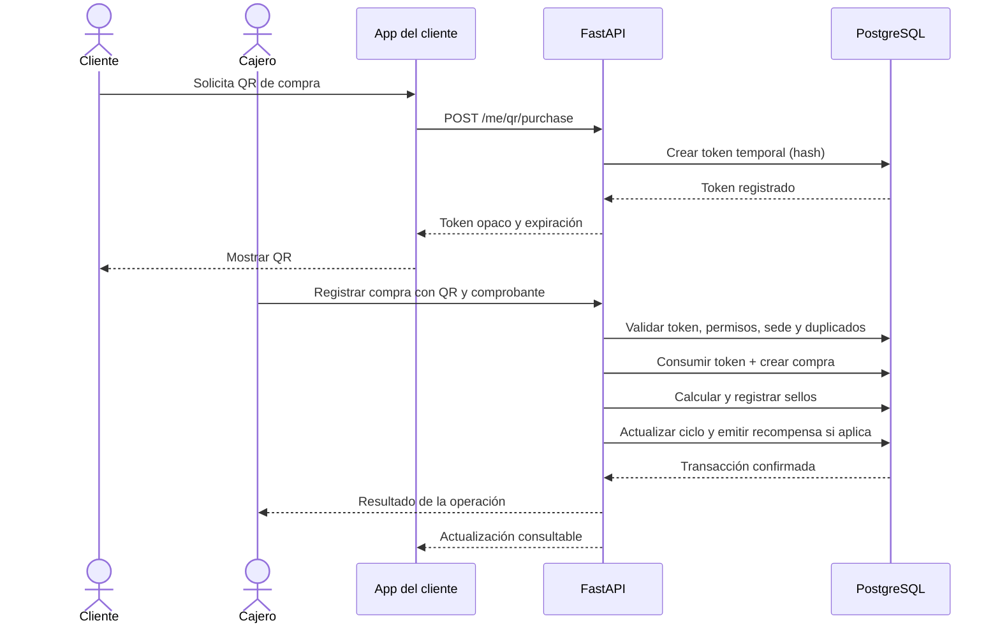

## 11.4. Validaciones obligatorias

- Token válido, no vencido y no consumido.
- Cliente existente y habilitado.
- Empleado autenticado.
- Empleado autorizado para la sede.
- Sede activa.
- Sede asociada al programa.
- Referencia de comprobante no duplicada.
- Importe válido y no negativo.
- Moneda permitida.
- Compra no cancelada ni procesada.
- Regla comercial vigente.

## 11.5. Límites del QR

El QR temporal reduce reutilización y fraude casual, pero no garantiza por sí solo que una compra real haya sido pagada. Para la primera versión, el empleado confirmará el pago y registrará la referencia de comprobante. La integración con un POS o una fuente de ventas confiable será una mejora posterior.

## 11.6. Contingencia

Si el dispositivo no puede escanear el QR o hay un problema técnico, un supervisor autorizado podrá registrar una operación de excepción con:

- Cliente.
- Sede.
- Comprobante.
- Importe.
- Motivo.
- Responsable.
- Marca de operación manual.

La excepción debe quedar auditada y no debe permitir que un empleado se adjudique sellos sin comprobante o autorización.

---

# 12. Modelo multisedes

## 12.1. Estructura conceptual

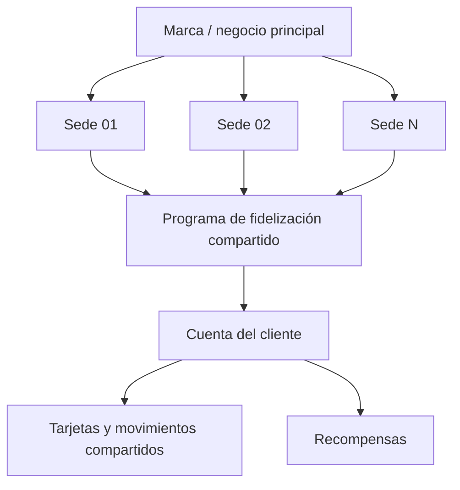

## 12.2. Reglas

- Una cuenta puede comprar en cualquier sede participante.
- El saldo de sellos se comparte entre sedes vinculadas al mismo programa.
- Cada compra conserva la sede donde se realizó.
- Cada redención conserva la sede donde se utilizó.
- Los permisos del empleado se limitan a las sedes asignadas.
- Una sede puede quedar desactivada sin borrar el histórico.
- Las recompensas podrán habilitarse globalmente o para sedes específicas.
- Los reportes deberán permitir comparar sedes y consultar el total del negocio.

## 12.3. Ejemplo

Un cliente consigue:

- 3 sellos en la sede Centro.
- 2 sellos en la sede Cabecera.
- 3 sellos en la sede Cañaveral.

Total: 8 sellos. El sistema completa la tarjeta y emite una recompensa según las condiciones del programa.

Los nombres de sedes son ilustrativos; no representan ubicaciones confirmadas.

---

# 13. Notificaciones, campañas y geofencing

## 13.1. Objetivo

La comunicación debe hacer que el cliente se sienta recordado y bienvenido. No debe reducirse a promociones agresivas.

## 13.2. Categorías

### Transaccionales
- Compra registrada.
- Sello recibido.
- Tarjeta completada.
- Recompensa emitida.
- Recompensa redimida.
- Recompensa próxima a vencer, si se habilita.

### Comerciales
- Producto nuevo.
- Promoción.
- Evento.
- Campaña de temporada.
- Invitación a visitar la cafetería.

### Automatizadas
- Recordatorio por inactividad.
- Recordatorio de recompensa próxima a vencer.
- Cumpleaños, si se recopila la fecha con finalidad y autorización apropiadas.
- Campañas basadas en comportamiento agregado o segmentos aprobados.

### Proximidad
- Mensaje al entrar en una región definida alrededor de una sede, si el cliente activó la función y el sistema operativo lo permite.

## 13.3. Ejemplos de tono

- «Hace falta tu visita para tener un día excelente. Te esperamos con tu café favorito».
- «Recordemos ese café que compartimos. ¿Hay que repetir?».
- «¡Estás muy cerca de tu recompensa! Nos encantará verte pronto».
- «¡Lo lograste! Tu próximo regalo ya está esperando por ti».
- «Estás cerca de tu lugar favorito. Tal vez sea un buen momento para un café».

Los textos finales deben respetar la identidad y el tono que apruebe la marca.

## 13.4. Frecuencia inicial propuesta

- Máximo de una notificación comercial al día.
- Máximo de tres notificaciones comerciales por semana.
- Horario de envío configurable.
- Prevención de mensajes duplicados.
- Exclusión de usuarios que no aceptaron la categoría comercial.
- Transaccionales separados de marketing para no ocultar información operativa importante.

Estos límites son recomendaciones iniciales y deben poder ajustarse por el propietario.

## 13.5. Segmentación

Segmentos posibles:

- Clientes activos recientemente.
- Clientes sin compras durante cierto periodo.
- Clientes con recompensa disponible.
- Clientes próximos a completar tarjeta.
- Clientes de determinadas sedes.
- Clientes que aceptaron recibir promociones.

La segmentación no debe utilizar datos sensibles ni criterios discriminatorios.

## 13.6. Geofencing

Cada sede podrá tener:

- Latitud y longitud.
- Radio de geocerca.
- Estado de la función.
- Mensaje asociado.
- Horario permitido.
- Frecuencia máxima por usuario.

El dispositivo detectará la entrada a la zona con servicios nativos. La web no debe prometer monitoreo continuo de ubicación en segundo plano.

### Consideraciones por plataforma

- Android: permisos de ubicación, requisitos para segundo plano y políticas de distribución deben revisarse para la versión objetivo.
- iOS: el monitoreo de regiones está sujeto a permisos y límites de Core Location.
- Web: se puede solicitar ubicación durante una sesión, pero no equivale a geofencing persistente cuando la pestaña está cerrada.

Recomendación de privacidad: procesar el evento de proximidad localmente cuando sea viable y no almacenar un historial continuo de ubicaciones. La ubicación debe ser opcional y su finalidad separada del consentimiento de marketing.

---

# 14. Arquitectura tecnológica

## 14.1. Tecnologías recomendadas

| Capa | Tecnología | Responsabilidad |
|---|---|---|
| App móvil | Ionic + Vue 3 | Interfaz móvil |
| Empaquetado móvil | Capacitor | Acceso a capacidades nativas y distribución |
| Cliente web | Vue 3 + TypeScript | Experiencia web del cliente |
| Panel web | Vue 3 + TypeScript | Administración y caja |
| UI | Tailwind CSS | Diseño y responsive |
| Backend | Python + FastAPI | API, validación y reglas de negocio |
| Base de datos | PostgreSQL | Datos transaccionales |
| Autenticación | Supabase Auth | Identidad y credenciales |
| Almacenamiento | Supabase Storage o S3 compatible | Banners y productos |
| Push | Firebase Cloud Messaging | Notificaciones push |
| Cola y tareas | Redis + Celery | Procesos programados y tareas asíncronas |
| Migraciones | Alembic | Versionado de esquema |
| Pruebas backend | Pytest | Pruebas unitarias e integración |
| Pruebas web | Playwright | Pruebas de interfaz y flujos |
| Contenedores | Docker | Entorno reproducible |
| CI/CD | GitHub Actions | Pruebas y despliegue |

## 14.2. Justificación

### Ionic Vue + Capacitor
Permite aprovechar Vue y TypeScript en móvil y reutilizar componentes o tipos entre aplicaciones. Capacitor conecta la app con cámara, notificaciones y funcionalidades nativas. Geofencing requiere una integración específica y pruebas por sistema operativo.

### Vue 3 + TypeScript
Permite crear interfaces mantenibles y compartir contratos de datos, validadores y componentes visuales.

### FastAPI
Centraliza las reglas de fidelización y permite documentar la API mediante OpenAPI.

### PostgreSQL
Permite utilizar relaciones, restricciones únicas, transacciones y bloqueos para proteger operaciones sensibles.

### Supabase Auth
Gestiona la identidad. FastAPI debe verificar los JWT y mantener la autorización del negocio. Las claves privilegiadas nunca deben exponerse en los clientes.

### Firebase Cloud Messaging
Transporta mensajes push a dispositivos compatibles. En iOS se integra con APNs. En web, las notificaciones requieren las capacidades del navegador, HTTPS y service worker.

### Redis + Celery
Permite ejecutar vencimientos, campañas programadas y tareas que no deben bloquear la respuesta de una petición web.

## 14.3. Diagrama de arquitectura

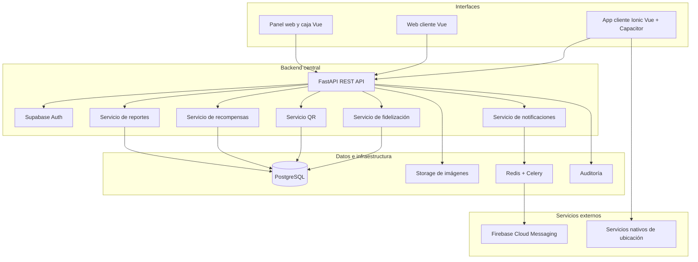

## 14.4. Separación de responsabilidades

- La app móvil maneja presentación y capacidades nativas.
- La web del cliente maneja presentación web.
- El panel controla operaciones administrativas y de caja.
- FastAPI valida toda operación comercial.
- PostgreSQL conserva la fuente de verdad.
- Supabase Auth gestiona credenciales e identidad.
- Storage conserva recursos multimedia.
- Celery/Redis ejecuta tareas programadas.
- FCM distribuye notificaciones.

## 14.5. Acceso a datos

Recomendación: las tablas operativas de negocio se consultan y modifican a través de FastAPI. No se debe entregar una credencial de base de datos a los clientes. Si se habilita acceso directo a recursos de Supabase, será solamente bajo políticas RLS estrictas y una evaluación explícita; no es necesario para el diseño inicial.

---

# 15. Estructura del repositorio

Se propone un monorepositorio para conservar contratos compartidos y coordinar las aplicaciones.

```text
cafeteria-loyalty/
│
├── apps/
│   ├── customer-mobile/
│   │   ├── src/
│   │   ├── components/
│   │   ├── pages/
│   │   ├── composables/
│   │   ├── services/
│   │   └── capacitor.config.ts
│   │
│   ├── customer-web/
│   │   ├── src/
│   │   ├── components/
│   │   ├── views/
│   │   └── services/
│   │
│   ├── admin-web/
│   │   ├── src/
│   │   ├── modules/
│   │   │   ├── dashboard/
│   │   │   ├── customers/
│   │   │   ├── branches/
│   │   │   ├── employees/
│   │   │   ├── loyalty/
│   │   │   ├── purchases/
│   │   │   ├── rewards/
│   │   │   ├── products/
│   │   │   ├── banners/
│   │   │   ├── campaigns/
│   │   │   └── reports/
│   │   └── services/
│   │
│   └── shared/
│       ├── types/
│       ├── constants/
│       ├── validators/
│       └── ui/
│
├── backend/
│   ├── app/
│   │   ├── main.py
│   │   ├── core/
│   │   │   ├── config.py
│   │   │   ├── security.py
│   │   │   ├── permissions.py
│   │   │   └── logging.py
│   │   ├── api/
│   │   ├── modules/
│   │   │   ├── auth/
│   │   │   ├── users/
│   │   │   ├── businesses/
│   │   │   ├── stores/
│   │   │   ├── memberships/
│   │   │   ├── loyalty/
│   │   │   ├── cards/
│   │   │   ├── purchases/
│   │   │   ├── stamps/
│   │   │   ├── rewards/
│   │   │   ├── products/
│   │   │   ├── banners/
│   │   │   ├── notifications/
│   │   │   └── reports/
│   │   ├── models/
│   │   ├── schemas/
│   │   ├── repositories/
│   │   ├── services/
│   │   ├── integrations/
│   │   └── database/
│   ├── migrations/
│   ├── tests/
│   └── requirements.txt
│
├── workers/
│   ├── notifications/
│   ├── expirations/
│   └── campaigns/
│
├── infrastructure/
│   ├── docker/
│   ├── deployment/
│   └── monitoring/
│
├── documentation/
│   ├── requirements/
│   ├── architecture/
│   ├── database/
│   ├── api/
│   ├── security/
│   └── operations/
│
├── .env.example
├── docker-compose.yml
├── README.md
└── CONTRIBUTING.md
```

La estructura es una propuesta de organización, no un requisito de usar exactamente esos nombres. Se puede ajustar al iniciar el repositorio, manteniendo la separación entre interfaces, servicios, datos y documentación.

---

# 16. Modelo de datos y diccionario

## 16.1. Principios de diseño

- Identificadores UUID.
- Fechas almacenadas como `TIMESTAMPTZ` en UTC y mostradas en la zona horaria apropiada.
- Importes monetarios almacenados como enteros en la unidad mínima acordada (para COP, pesos enteros si no se manejan fracciones).
- Claves foráneas para preservar integridad.
- Restricciones `UNIQUE` contra duplicados.
- Movimientos de sellos y redenciones trazables.
- Versionado de programas y fotografías de condiciones.
- Eliminación lógica cuando haya una razón operativa; no usar borrado físico para movimientos comerciales.

## 16.2. Entidades principales

| Tabla | Propósito |
|---|---|
| `businesses` | Negocio o marca propietaria |
| `stores` | Sedes físicas |
| `profiles` | Datos de perfil vinculados al usuario autenticado |
| `business_memberships` | Relación usuario-negocio y rol |
| `membership_store_assignments` | Sedes a las que puede acceder un empleado |
| `loyalty_programs` | Programa de fidelización |
| `loyalty_program_versions` | Versiones de las reglas comerciales |
| `program_stores` | Sedes participantes |
| `loyalty_cards` | Tarjetas/ciclos de cada cliente |
| `purchases` | Compras registradas |
| `qr_tokens` | Tokens temporales para compra o redención |
| `stamp_movements` | Movimientos de sellos |
| `reward_definitions` | Catálogo de beneficios |
| `reward_store_eligibility` | Sedes autorizadas para una recompensa |
| `customer_rewards` | Instancias emitidas a clientes |
| `reward_redemptions` | Registro de utilización |
| `products` | Productos destacados |
| `banners` | Publicidad visual |
| `notification_campaigns` | Campañas |
| `notification_preferences` | Preferencias por categoría |
| `push_devices` | Tokens de dispositivos |
| `notification_deliveries` | Historial de entregas |
| `consents` | Autorizaciones y revocaciones |
| `audit_logs` | Bitácora de acciones administrativas |
| `idempotency_keys` | Control de solicitudes repetidas |

## 16.3. Diccionario de datos resumido

### `businesses`

- `id`: UUID, PK.
- `name`: nombre de marca.
- `legal_name`: razón social, si corresponde.
- `status`: activo/inactivo.
- `default_currency`: inicialmente COP.
- `timezone`: zona horaria por defecto.
- `created_at`, `updated_at`.

### `stores`

- `id`: UUID, PK.
- `business_id`: FK a negocio.
- `code`: código interno único dentro del negocio.
- `name`: nombre visible.
- `address`: dirección.
- `city`, `department`, `country`.
- `latitude`, `longitude`: coordenadas opcionales o requeridas si se usa geofencing.
- `timezone`: zona horaria.
- `opening_hours`: configuración estructurada de horarios.
- `phone`: teléfono opcional.
- `status`: activa/inactiva.
- `created_at`, `updated_at`.

### `profiles`

- `id`: UUID asociado al identificador del proveedor de autenticación.
- `full_name`: nombre.
- `email`: correo de contacto, si se replica por necesidad operativa.
- `phone`: teléfono opcional.
- `status`: estado de cuenta en el negocio.
- `created_at`, `updated_at`.

No duplicar credenciales ni hashes de contraseña en esta tabla.

### `business_memberships`

- `id`: UUID.
- `business_id`: FK.
- `user_id`: FK a profile.
- `role`: propietario, administrador, cajero, marketing u otro rol aprobado.
- `status`: activo/inactivo.
- `created_at`, `updated_at`.

### `membership_store_assignments`

- `membership_id`: FK.
- `store_id`: FK.
- `created_at`.

Permite que un empleado tenga acceso a una o varias sedes.

### `loyalty_programs`

- `id`: UUID.
- `business_id`: FK.
- `name`: nombre.
- `status`: borrador, activo, pausado o finalizado.
- `created_at`, `updated_at`.

La configuración detallada se conservará en versiones.

### `loyalty_program_versions`

- `id`: UUID.
- `program_id`: FK.
- `version_number`: entero.
- `stamps_required`: inicialmente 8.
- `minimum_purchase`: importe mínimo.
- `amount_per_stamp`: importe por sello.
- `max_stamps_per_purchase`: límite.
- `eligible_amount_policy`: política de cálculo.
- `stamp_expiry_days`: nullable si no vence.
- `reward_expiry_days`: nullable/configurable según política.
- `effective_from`, `effective_until`.
- `rules_snapshot`: JSONB para conservar parámetros complementarios.
- `created_by`, `created_at`.

### `program_stores`

- `program_id`: FK.
- `store_id`: FK.
- `active`: boolean.
- Clave única compuesta para el par programa-sede.

### `loyalty_cards`

- `id`: UUID.
- `customer_id`: FK.
- `program_id`: FK.
- `program_version_id`: FK o referencia de versión inicial.
- `cycle_number`: consecutivo por cliente/programa.
- `stamps_required_snapshot`: cantidad requerida para ese ciclo.
- `status`: accumulating, completed, expired, cancelled.
- `opened_at`, `completed_at`, `closed_at`.

Restricción única sugerida: cliente + programa + ciclo.

### `purchases`

- `id`: UUID.
- `business_id`: FK.
- `store_id`: FK.
- `customer_id`: FK.
- `cashier_id`: FK.
- `receipt_reference`: referencia del comprobante.
- `gross_amount`: importe bruto.
- `discount_amount`: descuentos reconocidos.
- `eligible_amount`: importe utilizado para calcular sellos.
- `currency`: COP.
- `program_version_id`: versión aplicada.
- `status`: confirmed, cancelled, partially_refunded, refunded, under_review.
- `idempotency_key`: relación o valor único apropiado.
- `created_at`, `cancelled_at`.

La unicidad de comprobante debe considerar el sistema real de numeración del POS. No asumir que una referencia es globalmente única si el proveedor reinicia consecutivos por caja o por fecha.

### `qr_tokens`

- `id`: UUID.
- `token_hash`: hash del token secreto.
- `user_id`: cliente asociado.
- `purpose`: purchase o redemption.
- `resource_id`: recompensa asociada, cuando el propósito sea redención.
- `expires_at`.
- `consumed_at`.
- `consumed_by`: cajero/sistema.
- `store_id`: si el token está restringido a una sede.
- `created_at`.

### `stamp_movements`

- `id`: UUID.
- `card_id`: FK.
- `purchase_id`: nullable para ajustes o expiraciones.
- `quantity`: cantidad positiva de sellos del movimiento, acompañada por un tipo que determina su efecto.
- `movement_type`: EARN, REVERSAL, EXPIRATION, ADJUSTMENT, CARRY_IN o CARRY_OUT, según diseño final.
- `reverses_movement_id`: referencia al movimiento revertido.
- `source_store_id`: sede de origen, si aplica.
- `created_by`: empleado o proceso.
- `reason`: motivo para movimientos manuales o excepcionales.
- `expires_at`: fecha de vencimiento de ese lote, cuando aplique.
- `created_at`.

La convención de signo debe ser única y documentada: por ejemplo, `quantity` positivo con `movement_type` que define si suma o resta, o cantidades con signo. No mezclar ambos esquemas.

### `reward_definitions`

- `id`: UUID.
- `business_id`: FK.
- `name`, `description`.
- `reward_type`: product, percentage_discount, fixed_discount, special.
- `value`: valor o referencia de producto según tipo.
- `terms_snapshot`: JSONB de condiciones.
- `status`.
- `starts_at`, `ends_at`.
- `created_at`, `updated_at`.

### `reward_store_eligibility`

- `reward_definition_id`: FK.
- `store_id`: FK.
- Clave compuesta.

### `customer_rewards`

- `id`: UUID.
- `customer_id`: FK.
- `definition_id`: FK.
- `card_id`: FK que originó la recompensa.
- `status`: AVAILABLE, REDEEMED, EXPIRED, CANCELLED, PENDING_REVIEW.
- `issued_at`, `expires_at`, `redeemed_at`.
- `terms_snapshot`: condiciones vigentes al emitir.

### `reward_redemptions`

- `id`: UUID.
- `customer_reward_id`: FK.
- `purchase_id`: FK, nullable si la redención se registra antes de generar el comprobante y el negocio aprueba esa secuencia.
- `store_id`: FK.
- `cashier_id`: FK.
- `status`: confirmed, reversed, under_review.
- `idempotency_key`.
- `created_at`, `reversed_at`.

### `products`

- `id`: UUID.
- `business_id`: FK.
- `name`, `description`.
- `price`: nullable.
- `currency`.
- `image_path`.
- `featured_order`: 1 a 5 o null.
- `available`: boolean.
- `published_at`, `updated_at`.

Se recomienda una restricción que impida dos productos en la misma posición activa dentro del negocio.

### `banners`

- `id`: UUID.
- `business_id`: FK.
- `title`, `description`.
- `image_path`.
- `target_url`: opcional y validada.
- `starts_at`, `ends_at`.
- `sort_order`.
- `status`.
- `created_at`, `updated_at`.

### `notification_campaigns`

- `id`: UUID.
- `business_id`: FK.
- `title`, `body`.
- `category`: transactional, marketing, automated o proximity.
- `audience_config`: JSONB validado.
- `scheduled_at`.
- `status`: draft, scheduled, sending, sent, cancelled, failed.
- `created_by`, `created_at`, `updated_at`.

### `notification_preferences`

- `user_id`: FK.
- `category`.
- `enabled`.
- `updated_at`.

### `push_devices`

- `id`: UUID.
- `user_id`: FK.
- `platform`: android, ios, web.
- `push_token`: cifrado o protegido según estrategia.
- `last_seen_at`.
- `active`.
- `created_at`, `updated_at`.

### `notification_deliveries`

- `id`: UUID.
- `campaign_id`: FK, nullable para transaccionales.
- `user_id`: FK.
- `device_id`: FK, nullable.
- `provider_message_id`: nullable.
- `status`: queued, sent, delivered, failed, opened si el proveedor o cliente permite comprobarlo.
- `sent_at`, `created_at`.

### `consents`

- `id`: UUID.
- `user_id`: FK.
- `purpose`: tratamiento, marketing, ubicación u otra finalidad documentada.
- `policy_version`.
- `status`: granted, revoked.
- `granted_at`, `revoked_at`.
- `evidence_metadata`: datos mínimos para acreditar la acción.

### `audit_logs`

- `id`: UUID.
- `business_id`: FK.
- `actor_id`: usuario o proceso.
- `store_id`: nullable.
- `action`.
- `entity_type`, `entity_id`.
- `before_data`, `after_data`: JSONB limitado y sin secretos.
- `reason`.
- `ip_address` y `user_agent` cuando exista justificación y política de conservación.
- `created_at`.

No guardar contraseñas, tokens completos, datos de tarjeta bancaria ni secretos en auditoría.

## 16.4. Relaciones principales

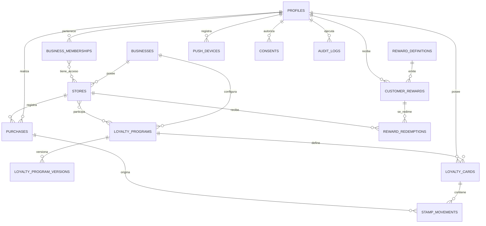

## 16.5. DDL ilustrativo

El siguiente SQL es un punto de partida para la discusión técnica. No es todavía una migración completa de producción: faltan, entre otros elementos, todas las FK, índices, restricciones, triggers o funciones transaccionales y políticas de borrado necesarias.

### Programa de fidelización

```sql
CREATE TABLE loyalty_programs (
    id UUID PRIMARY KEY,
    business_id UUID NOT NULL,
    name VARCHAR(120) NOT NULL,
    status VARCHAR(20) NOT NULL DEFAULT 'draft',
    created_at TIMESTAMPTZ NOT NULL DEFAULT NOW(),
    updated_at TIMESTAMPTZ NOT NULL DEFAULT NOW()
);

CREATE TABLE loyalty_program_versions (
    id UUID PRIMARY KEY,
    program_id UUID NOT NULL REFERENCES loyalty_programs(id),
    version_number INTEGER NOT NULL,
    stamps_required SMALLINT NOT NULL DEFAULT 8,
    minimum_purchase BIGINT NOT NULL,
    amount_per_stamp BIGINT NOT NULL,
    max_stamps_per_purchase SMALLINT NOT NULL,
    stamp_expiry_days INTEGER,
    reward_expiry_days INTEGER,
    effective_from TIMESTAMPTZ NOT NULL,
    effective_until TIMESTAMPTZ,
    rules_snapshot JSONB NOT NULL DEFAULT '{}'::jsonb,
    created_at TIMESTAMPTZ NOT NULL DEFAULT NOW(),
    UNIQUE(program_id, version_number),
    CHECK (stamps_required > 0),
    CHECK (minimum_purchase >= 0),
    CHECK (amount_per_stamp > 0),
    CHECK (max_stamps_per_purchase >= 1)
);
```

### Compras

```sql
CREATE TABLE purchases (
    id UUID PRIMARY KEY,
    business_id UUID NOT NULL,
    store_id UUID NOT NULL,
    customer_id UUID NOT NULL,
    cashier_id UUID NOT NULL,
    receipt_reference VARCHAR(100) NOT NULL,
    gross_amount BIGINT NOT NULL,
    discount_amount BIGINT NOT NULL DEFAULT 0,
    eligible_amount BIGINT NOT NULL,
    currency CHAR(3) NOT NULL DEFAULT 'COP',
    program_version_id UUID NOT NULL,
    status VARCHAR(30) NOT NULL DEFAULT 'confirmed',
    created_at TIMESTAMPTZ NOT NULL DEFAULT NOW(),
    cancelled_at TIMESTAMPTZ,
    CHECK (gross_amount >= 0),
    CHECK (discount_amount >= 0),
    CHECK (eligible_amount >= 0),
    UNIQUE (business_id, store_id, receipt_reference)
);
```

La restricción de referencia deberá ajustarse al formato real de comprobantes y cajas del establecimiento.

### Movimientos de sellos

```sql
CREATE TABLE stamp_movements (
    id UUID PRIMARY KEY,
    card_id UUID NOT NULL,
    purchase_id UUID,
    quantity SMALLINT NOT NULL,
    movement_type VARCHAR(20) NOT NULL,
    reverses_movement_id UUID,
    source_store_id UUID,
    created_by UUID,
    reason TEXT,
    expires_at TIMESTAMPTZ,
    created_at TIMESTAMPTZ NOT NULL DEFAULT NOW(),
    CHECK (quantity > 0),
    CHECK (movement_type IN (
        'EARN', 'REVERSAL', 'EXPIRATION',
        'ADJUSTMENT', 'CARRY_IN', 'CARRY_OUT'
    ))
);
```

Esta variante usa cantidades positivas y tipo de movimiento para determinar el efecto. La lógica debe documentar claramente cómo se calcula el saldo neto.

### QR temporales

```sql
CREATE TABLE qr_tokens (
    id UUID PRIMARY KEY,
    token_hash TEXT NOT NULL UNIQUE,
    user_id UUID NOT NULL,
    purpose VARCHAR(20) NOT NULL,
    resource_id UUID,
    store_id UUID,
    expires_at TIMESTAMPTZ NOT NULL,
    consumed_at TIMESTAMPTZ,
    consumed_by UUID,
    created_at TIMESTAMPTZ NOT NULL DEFAULT NOW(),
    CHECK (purpose IN ('PURCHASE', 'REDEMPTION'))
);
```

### Instancias de recompensa

```sql
CREATE TABLE customer_rewards (
    id UUID PRIMARY KEY,
    customer_id UUID NOT NULL,
    definition_id UUID NOT NULL,
    card_id UUID NOT NULL,
    status VARCHAR(20) NOT NULL DEFAULT 'AVAILABLE',
    issued_at TIMESTAMPTZ NOT NULL DEFAULT NOW(),
    expires_at TIMESTAMPTZ,
    redeemed_at TIMESTAMPTZ,
    terms_snapshot JSONB NOT NULL DEFAULT '{}'::jsonb,
    CHECK (status IN (
        'AVAILABLE', 'REDEEMED', 'EXPIRED',
        'CANCELLED', 'PENDING_REVIEW'
    ))
);
```

---

# 17. Especificación de API REST

## 17.1. Convenciones

URL base:

```text
https://api.dominio.com/api/v1/
```

- Formato de intercambio: JSON.
- Transporte: HTTPS.
- Identidad: JWT emitido por Supabase Auth.
- Autorización: roles y asignaciones de sede verificadas por backend.
- Fechas: ISO 8601 en UTC.
- Identificadores: UUID.
- Paginación: `limit` y `cursor` o `page`/`page_size`, con una convención uniforme.
- Errores: formato estructurado y sin información sensible.

## 17.2. Autenticación

Supabase Auth administra el registro, inicio de sesión, verificación y recuperación. FastAPI valida firma, emisor, audiencia, expiración y demás claims requeridos del JWT.

Endpoints de perfil:

| Método | Endpoint | Función |
|---|---|---|
| GET | `/me` | Consultar perfil propio |
| PATCH | `/me` | Actualizar campos permitidos |
| GET | `/me/loyalty/cards` | Consultar tarjetas |
| GET | `/me/loyalty/movements` | Consultar movimientos |
| GET | `/me/rewards` | Consultar recompensas |
| GET | `/me/purchases` | Consultar compras |
| GET | `/me/notifications` | Consultar notificaciones |
| PATCH | `/me/notification-preferences` | Cambiar preferencias |
| POST | `/devices/register` | Registrar dispositivo push |
| DELETE | `/devices/{device_id}` | Desvincular dispositivo |

## 17.3. QR y compras

| Método | Endpoint | Función |
|---|---|---|
| POST | `/me/qr/purchase` | Generar QR temporal de compra |
| POST | `/cashier/purchases` | Registrar compra escaneada |
| GET | `/cashier/purchases/{id}` | Consultar compra |
| POST | `/cashier/purchases/{id}/cancel` | Solicitar cancelación autorizada |
| GET | `/admin/purchases` | Listar compras |
| GET | `/admin/purchases/{id}` | Ver detalle |

### Ejemplo: registrar compra

```http
POST /api/v1/cashier/purchases
Authorization: Bearer <JWT>
Idempotency-Key: 7be5a4c2-unique-operation
Content-Type: application/json
```

```json
{
  "qr_token": "opaque-temporary-token",
  "store_id": "uuid-sede",
  "receipt_reference": "FAC-000184",
  "gross_amount": 30000,
  "discount_amount": 0,
  "currency": "COP"
}
```

El empleado no envía `stamps_awarded`; el backend calcula los sellos.

Respuesta ilustrativa:

```json
{
  "purchase_id": "uuid-compra",
  "status": "confirmed",
  "eligible_amount": 30000,
  "stamps_awarded": 3,
  "card_progress": {
    "stamps": 6,
    "required": 8,
    "percentage": 75
  },
  "reward_created": false
}
```

El ejemplo supone que el importe por sello es $10.000 COP, el mínimo de compra se cumple y el máximo es de tres sellos. No representa una configuración comercial aprobada.

## 17.4. Recompensas

| Método | Endpoint | Función |
|---|---|---|
| GET | `/me/rewards` | Consultar beneficios |
| POST | `/me/rewards/{id}/qr` | Crear QR temporal de redención |
| POST | `/cashier/redemptions` | Confirmar redención |
| GET | `/admin/rewards` | Consultar instancias de recompensa |
| POST | `/admin/reward-definitions` | Crear definición |
| PATCH | `/admin/reward-definitions/{id}` | Actualizar definición |
| GET | `/admin/redemptions` | Consultar redenciones |

## 17.5. Administración

| Método | Endpoint | Función |
|---|---|---|
| GET | `/admin/dashboard` | Indicadores |
| GET | `/admin/customers` | Listar clientes |
| PATCH | `/admin/customers/{id}/status` | Activar o bloquear cuenta |
| GET | `/admin/stores` | Consultar sedes |
| POST | `/admin/stores` | Crear sede |
| PATCH | `/admin/stores/{id}` | Modificar sede |
| GET | `/admin/loyalty-programs` | Consultar programas |
| POST | `/admin/loyalty-programs` | Crear programa |
| PATCH | `/admin/loyalty-programs/{id}` | Modificar programa mediante nueva versión |
| GET | `/admin/products` | Listar productos |
| POST | `/admin/products` | Crear producto |
| PATCH | `/admin/products/{id}` | Modificar producto |
| GET | `/admin/banners` | Listar banners |
| POST | `/admin/banners` | Crear banner |
| PATCH | `/admin/banners/{id}` | Modificar banner |

## 17.6. Notificaciones

| Método | Endpoint | Función |
|---|---|---|
| GET | `/admin/campaigns` | Consultar campañas |
| POST | `/admin/campaigns` | Crear campaña |
| PATCH | `/admin/campaigns/{id}` | Editar campaña |
| POST | `/admin/campaigns/{id}/send` | Iniciar envío |
| POST | `/admin/campaigns/{id}/cancel` | Cancelar campaña pendiente |
| GET | `/admin/campaigns/{id}/deliveries` | Consultar entregas |

## 17.7. Idempotencia

Las operaciones que crean compras, sellos o redenciones deben aceptar una clave de idempotencia:

```http
Idempotency-Key: uuid-de-operacion
```

Si una petición se repite debido a una conexión lenta o doble clic, el servidor devolverá el resultado de la operación original o una respuesta equivalente, sin generar una segunda compra o redención.

## 17.8. Respuestas de error

Formato sugerido:

```json
{
  "error": {
    "code": "QR_EXPIRED",
    "message": "El código QR expiró. Solicita uno nuevo.",
    "request_id": "uuid-request"
  }
}
```

Códigos posibles:

- `AUTH_REQUIRED`.
- `FORBIDDEN`.
- `CUSTOMER_DISABLED`.
- `STORE_DISABLED`.
- `STORE_ACCESS_DENIED`.
- `QR_EXPIRED`.
- `QR_ALREADY_USED`.
- `PURCHASE_DUPLICATE`.
- `PURCHASE_INVALID_AMOUNT`.
- `REWARD_EXPIRED`.
- `REWARD_ALREADY_REDEEMED`.
- `IDEMPOTENCY_CONFLICT`.
- `VALIDATION_ERROR`.
- `INTERNAL_ERROR`.

Los mensajes públicos no deben revelar información interna o sensible.

---

# 18. Seguridad y protección de datos

## 18.1. Principio general

No existe seguridad absoluta. La meta es reducir riesgos con capas de protección, controles verificables, monitoreo y procedimientos de recuperación.

## 18.2. Autenticación

- Supabase Auth para credenciales e identidad.
- Verificación de correo cuando corresponda.
- Recuperación segura de contraseña.
- MFA obligatorio o fuertemente recomendado para administradores.
- Tokens de duración limitada y renovación controlada.
- Revocación de sesiones cuando una cuenta privilegiada se desactive o exista incidente.
- Nunca guardar contraseñas en texto plano.

## 18.3. Autorización

- RBAC en backend.
- Alcance por negocio y sede.
- Verificación de propiedad y acceso de cada recurso.
- Separación entre operaciones de cliente, cajero, administrador y propietario.
- No confiar en permisos enviados desde el navegador.
- Evitar que un usuario modifique identificadores para consultar datos ajenos.

## 18.4. Protección de API

- HTTPS obligatorio.
- Validación de parámetros y cuerpos con Pydantic.
- Límites de solicitudes por usuario, IP y operación.
- Protección contra abuso de endpoints de QR.
- Idempotencia.
- Restricciones únicas en base de datos.
- Transacciones para compra, sellos y redención.
- Control de tamaño y tipo de archivos.
- Validación de URLs y contenido subido.
- Gestión segura de secretos.
- Logs sin credenciales ni tokens.

## 18.5. Protección de base de datos

- Usuarios de base de datos con privilegios mínimos.
- Separación de ambientes.
- Acceso de red restringido.
- Cifrado en tránsito y en reposo según capacidades del proveedor.
- Backups cifrados.
- Migraciones revisadas.
- Auditoría de operaciones sensibles.
- No exponer credenciales administrativas a los clientes.

## 18.6. Protección del QR

- Token aleatorio y opaco.
- Hash almacenado, no token secreto en claro.
- Vigencia breve.
- Un solo uso.
- Propósito explícito (compra/redención).
- Validación de identidad y sede.
- Consumo atómico.
- Rate limiting.
- No incluir correo, teléfono, nombre, contraseña ni JWT en el QR.

## 18.7. Protección de archivos

- Almacenamiento privado cuando los recursos no sean públicos.
- URLs firmadas con expiración para cargas o descargas autorizadas.
- Validación de MIME real y extensión.
- Límite de tamaño.
- Procesamiento de imágenes para eliminar metadatos innecesarios.
- Nombres de archivo no confiables tratados como datos, no como rutas.

## 18.8. Privacidad en Colombia

El diseño debe considerar la Ley Estatutaria 1581 de 2012, su reglamentación y las instrucciones vigentes de la autoridad competente.

Requisitos de producto:

- Política de tratamiento de datos personales.
- Aviso de privacidad.
- Finalidades claras.
- Autorización demostrable cuando sea necesaria.
- Mecanismos para consultar, actualizar y rectificar.
- Procedimiento para reclamos y solicitudes.
- Gestión de revocación y supresión cuando legalmente corresponda.
- Retención limitada y justificada.
- Registro de versiones de política y consentimientos.

Separar, como mínimo:

1. Tratamiento necesario para cuenta y fidelización.
2. Marketing y comunicaciones comerciales.
3. Permiso de notificaciones del dispositivo.
4. Uso opcional de ubicación.

El permiso del sistema operativo y la autorización de tratamiento de datos son conceptos diferentes. Se deben gestionar ambos cuando correspondan.

Se debe definir con asesoría jurídica quién es responsable y quién encargado del tratamiento, especialmente por el uso de servicios cloud, autenticación, almacenamiento y notificaciones.

---

# 19. Requisitos no funcionales

| ID | Requisito | Objetivo inicial verificable |
|---|---|---|
| RNF-001 | Rendimiento | p95 inferior a 800 ms en consultas habituales del backend, excluyendo terceros |
| RNF-002 | Disponibilidad | Objetivo mensual de 99,5 %, sujeto al proveedor e infraestructura |
| RNF-003 | Seguridad | Toda operación protegida requiere identidad y autorización |
| RNF-004 | Consistencia | No se permiten compras, sellos ni redenciones duplicadas |
| RNF-005 | Compatibilidad | Navegadores modernos y versiones móviles objetivo acordadas |
| RNF-006 | Adaptabilidad | Interfaz en móvil, tablet y escritorio |
| RNF-007 | Escalabilidad | Agregar sedes y usuarios sin rediseño completo |
| RNF-008 | Mantenibilidad | Código modular, documentado y versionado |
| RNF-009 | Recuperación | Procedimiento de respaldo y restauración probado |
| RNF-010 | Privacidad | Cumplimiento del marco aplicable |
| RNF-011 | Accesibilidad | Objetivo WCAG 2.2 AA |
| RNF-012 | Internacionalización | Español y COP como configuración inicial |

Los objetivos de rendimiento y disponibilidad se medirán con pruebas y monitoreo. No deben publicitarse como garantías hasta tener mediciones reales.

## 19.1. Compatibilidad

Antes de publicar se definirán:

- Versiones mínimas de Android e iOS.
- Navegadores web soportados.
- Resoluciones y tamaños mínimos.
- Permisos requeridos.
- Política de actualizaciones.
- Pruebas en dispositivos reales.

## 19.2. Accesibilidad

- Contraste suficiente.
- Etiquetas para lectores de pantalla.
- Navegación por teclado en web.
- Áreas táctiles adecuadas.
- No depender únicamente del color para indicar estados.
- Texto escalable.
- Mensajes de error comprensibles.

---

# 20. Auditoría, monitoreo y respaldo

## 20.1. Auditoría

Toda operación sensible debe conservar:

- Actor (usuario o proceso).
- Acción.
- Entidad afectada.
- Identificador de entidad.
- Fecha y hora.
- Sede, si aplica.
- Motivo, cuando sea operación de excepción.
- Estado anterior y posterior limitado a datos necesarios.

La bitácora no debe guardar secretos ni datos personales excesivos.

## 20.2. Monitoreo

Monitorear como mínimo:

- Disponibilidad de API.
- Errores 4xx/5xx.
- Latencia.
- Conexiones de base de datos.
- Cola de trabajos.
- Fallos de notificación.
- Fallos de QR.
- Compras rechazadas por duplicado.
- Errores de redención.
- Uso y capacidad de almacenamiento.

## 20.3. Respaldo

Recomendaciones iniciales:

- Copias automáticas de base de datos.
- Copias independientes del entorno principal.
- Cifrado.
- Retención definida.
- Restauración probada periódicamente.
- Procedimiento de incidente.

Objetivos propuestos para planificación, sujetos a viabilidad del proveedor:

- RPO inicial: máximo 24 horas.
- RTO inicial: máximo 4 horas.

Si el negocio necesita recuperar compras con pérdida menor a 24 horas, deberá contratar y configurar recuperación a un punto en el tiempo (PITR) u otra solución equivalente y reducir el RPO.

---

# 21. Plan de pruebas

## 21.1. Pruebas unitarias

- Cálculo de sellos.
- Validación de importe mínimo.
- Máximo por compra.
- Cálculo del valor elegible.
- Redondeo hacia abajo.
- Arrastre de sellos sobrantes.
- Completar tarjeta.
- Emisión de recompensa.
- Vencimiento individual.
- Reversión.
- Validación de permisos.
- Límites de frecuencia de notificación.

## 21.2. Pruebas de integración

| Caso | Resultado esperado |
|---|---|
| Cliente escanea QR vigente | Se puede registrar la compra |
| QR vencido | Se rechaza |
| QR ya utilizado | Se rechaza |
| QR de redención usado como compra | Se rechaza por propósito incorrecto |
| Compra duplicada | Se rechaza o devuelve resultado idempotente |
| Cajero de otra sede | Acceso denegado |
| Cliente bloqueado | No acumula ni redime |
| Sede desactivada | No registra operaciones nuevas |
| Importe inferior al mínimo | Cero sellos |
| Compra que completa tarjeta | Se emite recompensa |
| Compra con sellos sobrantes | El remanente pasa al nuevo ciclo según política aprobada |
| Recompensa vencida | No puede redimirse |
| Redención simultánea | Solo una operación se confirma |
| Compra cancelada | Se generan reversiones correspondientes |
| Cambio de programa | Las compras conservan versión aplicada |

## 21.3. Pruebas de concurrencia

- Dos compras simultáneas para un cliente.
- Dos cajeros intentando redimir la misma recompensa.
- Doble envío de la misma solicitud.
- Reintento después de timeout.
- Vencimiento que coincide con una redención.

## 21.4. Pruebas de seguridad

- Intento de acceder a clientes ajenos.
- Manipulación de `store_id`.
- Empleado que intenta operar en una sede no autorizada.
- Reutilización de QR.
- Fuerza bruta de tokens.
- Subida de archivos inválidos.
- Acceso a rutas de administración desde rol cliente.
- Token vencido o inválido.
- Acceso a secretos desde bundle móvil/web.

## 21.5. Pruebas de usuario

Se recomienda hacer una prueba piloto en una sede con clientes y empleados reales, pero en un grupo controlado. Se evaluará:

- Tiempo para registrar una compra.
- Facilidad para encontrar el QR.
- Comprensión de la tarjeta.
- Claridad de la recompensa.
- Comodidad de la pantalla de inicio.
- Entendimiento de los mensajes.
- Facilidad de uso por parte del cajero.

---

# 22. Criterios de aceptación del MVP

El MVP se considerará funcionalmente aceptable cuando:

1. Un cliente pueda registrarse, verificar su cuenta y recuperar acceso.
2. El cliente pueda iniciar sesión en web y en móvil.
3. La administración pueda crear y gestionar varias sedes.
4. Los empleados tengan permisos limitados a sus sedes.
5. El cliente pueda mostrar un QR temporal.
6. Un cajero autorizado pueda escanearlo y registrar una compra.
7. El backend calcule los sellos de acuerdo con la versión de programa aplicable.
8. Una compra no pueda generar sellos dos veces.
9. Los sellos se acumulen en las sedes participantes.
10. Al completar ocho sellos se genere la recompensa configurada.
11. Los sellos sobrantes pasen a un ciclo nuevo, si se aprueba la política de arrastre.
12. El cliente pueda consultar compras, movimientos, tarjetas y recompensas.
13. El cajero pueda redimir una recompensa mediante QR.
14. Una recompensa no pueda redimirse dos veces.
15. El administrador pueda bloquear y habilitar cuentas.
16. Se puedan modificar los cinco productos destacados.
17. Se puedan cargar, activar y desactivar banners.
18. Se puedan crear y enviar notificaciones básicas.
19. Se mantengan registros auditables de las operaciones sensibles.
20. Se pruebe la restauración de respaldos.
21. Se ejecuten pruebas de seguridad y privacidad antes de producción.

## 22.1. Checklist de aceptación

- [ ] Registro, verificación y recuperación de cuenta.
- [ ] Perfil de cliente.
- [ ] Aplicación móvil Android.
- [ ] Aplicación móvil iOS.
- [ ] Web de cliente.
- [ ] Panel administrativo.
- [ ] Administración de múltiples sedes.
- [ ] Roles y permisos por sede.
- [ ] Programa de ocho sellos.
- [ ] Cálculo combinado por compra e importe.
- [ ] QR temporal de compra.
- [ ] Protección contra duplicados.
- [ ] Tarjetas y ciclos.
- [ ] Arrastre de sellos sobrantes, si se aprueba.
- [ ] Emisión de recompensas.
- [ ] QR de redención.
- [ ] Vencimientos configurables.
- [ ] Cinco productos destacados.
- [ ] Banners administrables.
- [ ] Notificaciones básicas.
- [ ] Preferencias del cliente.
- [ ] Auditoría.
- [ ] Respaldos y restauración.
- [ ] Pruebas de seguridad.
- [ ] Prueba piloto.

---

# 23. Plan de desarrollo y entregas

## Etapa 1. Análisis y diseño

Entregables:

- Aprobación de reglas comerciales.
- Historias de usuario.
- Casos de uso.
- Diseño de arquitectura.
- Modelo entidad-relación.
- Prototipo en Figma.
- Identidad visual inicial.
- Matriz de permisos.

## Etapa 2. Infraestructura y núcleo

Entregables:

- Repositorio.
- Entornos dev/QA/prod.
- Base PostgreSQL.
- Migraciones iniciales.
- Supabase Auth.
- Perfiles y roles.
- Gestión de sedes.
- API base.

## Etapa 3. Motor de fidelización

Entregables:

- Programas versionados.
- Tarjetas/ciclos.
- Cálculo de sellos.
- Movimientos.
- Vencimientos.
- Arrastre.
- Recompensas.
- Pruebas unitarias y transaccionales.

## Etapa 4. QR, compras y caja

Entregables:

- QR temporal de compra.
- Escáner en la interfaz de caja.
- Registro de comprobantes.
- Idempotencia.
- Registro de sellos.
- QR de redención.
- Reversión y auditoría.

## Etapa 5. Aplicación del cliente y panel

Entregables:

- Inicio.
- Registro e inicio de sesión.
- Tarjeta.
- QR.
- Historial.
- Recompensas.
- Productos.
- Perfil.
- Panel de administración.
- Gestión de clientes y sedes.

## Etapa 6. Contenido y notificaciones

Entregables:

- Banners.
- Cinco productos destacados.
- Registro de dispositivos.
- FCM.
- Campañas manuales.
- Preferencias.
- Programaciones.

## Etapa 7. Funciones inteligentes

Entregables:

- Automatización de inactividad.
- Segmentación.
- Geofencing nativo.
- Reglas de frecuencia.
- Reportes ampliados.

## Etapa 8. QA, publicación y operación

Entregables:

- Pruebas integrales.
- Revisión de seguridad.
- Pruebas en dispositivos reales.
- Política de privacidad y consentimientos aprobados.
- Restauración de respaldos validada.
- Documentación de operación.
- Publicación.
- Monitoreo.

## 23.1. Orden recomendado de programación

1. Base de datos y migraciones.
2. Autenticación y autorización multisedes.
3. Sedes, empleados y roles.
4. Motor de sellos.
5. Ciclos y recompensas.
6. Compras y QR.
7. Redenciones.
8. API administrativa.
9. Aplicación cliente.
10. Panel web y caja.
11. Productos y banners.
12. Notificaciones.
13. Geofencing.
14. QA y publicación.

El orden se puede adaptar, pero no se recomienda empezar por geofencing o animaciones antes de tener correcto el motor transaccional.

---

# 24. Alcance excluido y ampliaciones futuras

| Funcionalidad | Clasificación | Observación |
|---|---|---|
| Carrito y pagos | Fuera del MVP | Requeriría pasarela y proceso de pago |
| Domicilios | Fuera del MVP | Requeriría logística |
| Facturación electrónica | Integración futura | Depende de proveedor y obligaciones del negocio |
| Integración POS | Alta prioridad futura | Evitar registro manual cuando exista API confiable |
| Geofencing | Segunda entrega | Requiere permisos y pruebas nativas |
| Referidos | Futuro | Reglas antifraude y beneficios adicionales |
| IA para promociones | Futuro | Necesita datos, evaluación y criterios de privacidad |
| Analítica avanzada | Futuro | Cohortes y recurrencia |
| Varias marcas independientes | Fuera del alcance inicial | La estructura puede prepararse, pero no se asume en el MVP |

---

# 25. Decisiones pendientes

Estas decisiones deben confirmarse antes de implementar las reglas comerciales en producción.

| N.º | Tema | Pregunta que debe resolverse | Impacto |
|---:|---|---|---|
| 1 | Importe mínimo | ¿Cuál es el valor mínimo de compra para obtener sello? | Motor de sellos |
| 2 | Importe por sello | ¿Cuánto consumo elegible equivale a un sello? | Motor de sellos |
| 3 | Máximo por compra | ¿Cuántos sellos como máximo puede generar una compra? | Motor de sellos |
| 4 | Fórmula | ¿Una compra que supera el mínimo siempre gana al menos un sello? | Regla central |
| 5 | Descuentos | ¿Se calcula sobre bruto o neto de descuentos? | Compra |
| 6 | Impuestos | ¿El impuesto forma parte del importe elegible? | Compra |
| 7 | Propinas | ¿Se excluyen? Recomendación: sí. | Compra |
| 8 | Cortesías | ¿No generan sello? Recomendación: sí, excluir. | Compra |
| 9 | Devoluciones | ¿Cómo se revierte una compra parcial o total? | Auditoría y saldo |
| 10 | Tarjetas | ¿Se confirma arrastre de sellos sobrantes? | Ciclos |
| 11 | Vencimiento | ¿Cuántos días dura cada sello? | Procesos programados |
| 12 | Vencimiento de recompensa | ¿Cuántos días tiene el cliente para usarla? | Recompensas |
| 13 | Recompensas iniciales | ¿Qué regalos, productos o descuentos se ofrecerán? | Catálogo |
| 14 | Sedes | ¿Cuáles son las sedes, direcciones y horarios iniciales? | Multisedes |
| 15 | Empleados | ¿Quién podrá asignar sellos manuales? | Permisos |
| 16 | Comprobante | ¿Qué sistema genera los números de factura/ticket? | Duplicados |
| 17 | POS | ¿Existe un POS y ofrece API? | Integración futura |
| 18 | Notificaciones | ¿Cuáles categorías se activan inicialmente? | Comunicación |
| 19 | Frecuencia | ¿Se aprueban los límites sugeridos? | Marketing |
| 20 | Geofencing | ¿Qué radio y mensajes se utilizarán por sede? | Ubicación |
| 21 | Marca | ¿Cuál es el nombre, logo, paleta y tipografía oficiales? | Diseño |
| 22 | Datos | ¿Cuál es el responsable del tratamiento y quién es encargado? | Cumplimiento |
| 23 | Infraestructura | ¿Qué proveedor y presupuesto se aprobarán? | Despliegue |
| 24 | Aplicaciones | ¿Quién será titular de las cuentas de Play Store y App Store? | Publicación |

---

# 26. Ejemplos de punta a punta

## 26.1. Primera compra de un cliente

1. Cliente instala app o visita la web.
2. Registra cuenta y verifica correo.
3. Consulta la tarjeta vacía de ocho sellos.
4. Se dirige a una sede participante.
5. Muestra QR temporal.
6. Cajero registra compra.
7. Backend valida y calcula sellos.
8. Se registra el movimiento.
9. La app muestra progreso actualizado.

## 26.2. Acumulación entre sedes

Cliente:

| Sede | Sellos de esa compra | Total posterior |
|---|---:|---:|
| Centro | 3 | 3 |
| Cabecera | 2 | 5 |
| Cañaveral | 3 | 8 |

Resultado: tarjeta completa y recompensa emitida.

## 26.3. Compra que supera la meta

Estado inicial: 7 de 8 sellos.  
Compra válida: genera 3 sellos.

Resultado esperado con arrastre:

- Ciclo 1: recibe 1 sello, completa 8 y se emite recompensa.
- Ciclo 2: recibe los 2 sellos restantes.
- La operación mantiene una referencia única a la compra que originó los tres sellos.
- Los movimientos deben poder rastrearse por ciclo y compra.

## 26.4. Ejemplo de respuesta al registrar compra

```json
{
  "purchase_id": "uuid-compra",
  "status": "confirmed",
  "eligible_amount": 30000,
  "stamps_awarded": 3,
  "allocation": [
    { "card_cycle": 1, "stamps": 1 },
    { "card_cycle": 2, "stamps": 2 }
  ],
  "rewards_created": 1
}
```

La respuesta representa el caso en el que el cliente tenía siete sellos en el primer ciclo.

## 26.5. Cancelación de compra

1. Se consulta la compra original.
2. Se valida el permiso de quien solicita cancelación.
3. Se verifica que no esté ya cancelada.
4. Se crea un movimiento de reversión de sellos.
5. Se revisa el estado de recompensas vinculadas.
6. Se registra motivo y responsable.
7. Se notifica al cliente cuando corresponda.

Si una recompensa ya se utilizó, el caso debe pasar por la política de incidencias y no debe resolverse eliminando registros.

## 26.6. Ejemplo de notificación por inactividad

Regla de ejemplo:

- Evento: última compra hace 15 días.
- Condiciones: cliente activo, marketing aceptado, no recibió mensaje similar recientemente y horario permitido.
- Acción: enviar mensaje.

Mensaje:

> «Hace unos días compartimos una buena taza de café. ¿Repetimos? Te esperamos cuando quieras».

## 26.7. Ejemplo de notificación de proximidad

1. La app tiene permiso de ubicación para proximidad.
2. El cliente entra a la región definida alrededor de una sede.
3. El sistema operativo notifica el evento.
4. La app revisa horario, frecuencia y preferencias.
5. Presenta un aviso no invasivo.

Mensaje:

> «¡Estás cerca de tu lugar favorito! Tal vez sea un buen momento para un café».

---

# 27. Glosario

| Término | Definición |
|---|---|
| API | Interfaz para que las aplicaciones se comuniquen con el backend |
| Backend | Servicios centrales y reglas de negocio |
| Banner | Imagen o pieza promocional mostrada en la app |
| Capacitor | Runtime que permite ejecutar una app web dentro de una app nativa |
| Ciclo | Periodo individual de acumulación hasta completar la tarjeta |
| Consentimiento | Manifestación de autorización para una finalidad de tratamiento |
| FCM | Firebase Cloud Messaging, servicio de mensajería push |
| Geofencing | Detección de entrada o salida de una región geográfica |
| Idempotencia | Propiedad por la que repetir una solicitud no duplica su efecto |
| JWT | Token firmado utilizado para transportar afirmaciones de identidad |
| MFA | Autenticación multifactor |
| MVP | Producto mínimo viable, primera versión con alcance controlado |
| POS | Sistema de punto de venta |
| QR dinámico | Código temporal emitido para una operación concreta |
| RBAC | Control de acceso basado en roles |
| Redención | Uso efectivo de una recompensa |
| Sede | Establecimiento físico de la marca |
| Sello | Unidad de avance obtenida por una compra válida |
| Supabase Auth | Servicio de autenticación utilizado en la arquitectura propuesta |
| Tarjeta | Conjunto de sellos con una meta definida |
| RPO | Pérdida máxima de datos expresada como tiempo |
| RTO | Tiempo objetivo para recuperar el servicio |

---

# 28. Referencias técnicas y normativas

Las siguientes fuentes son puntos de partida para validar e implementar la solución. Antes de desarrollar o publicar, revisar la versión vigente de cada documentación y las políticas de las tiendas de aplicaciones.

## Tecnologías

- [Vue.js — documentación oficial](https://vuejs.org/guide/)
- [Ionic Framework — Vue](https://ionicframework.com/docs/vue/overview)
- [Capacitor — documentación](https://capacitorjs.com/docs)
- [FastAPI — documentación](https://fastapi.tiangolo.com/)
- [PostgreSQL — documentación](https://www.postgresql.org/docs/)
- [Supabase Auth — documentación](https://supabase.com/docs/guides/auth)
- [Supabase Storage — documentación](https://supabase.com/docs/guides/storage)
- [Firebase Cloud Messaging — documentación](https://firebase.google.com/docs/cloud-messaging)
- [Celery — documentación](https://docs.celeryq.dev/)
- [Redis — documentación](https://redis.io/docs/)
- [Alembic — documentación](https://alembic.sqlalchemy.org/)
- [Pytest — documentación](https://docs.pytest.org/)
- [Playwright — documentación](https://playwright.dev/docs/intro)
- [Docker — documentación](https://docs.docker.com/)

## Seguridad y privacidad

- [OWASP API Security Project](https://owasp.org/www-project-api-security/)
- [OWASP Application Security Verification Standard](https://owasp.org/www-project-application-security-verification-standard/)
- [Ley 1581 de 2012 — Gestor Normativo de Función Pública](https://www.funcionpublica.gov.co/eva/gestornormativo/norma.php?i=49981)
- [Superintendencia de Industria y Comercio — Protección de datos personales](https://www.sic.gov.co/tema/proteccion-de-datos-personales)

## Ubicación y notificaciones

- [Android — Geofencing](https://developer.android.com/develop/sensors-and-location/location/geofencing)
- [Apple — Monitoring the user's proximity to geographic regions](https://developer.apple.com/documentation/corelocation/monitoring-the-user-s-proximity-to-geographic-regions)
- [Apple — Core Location](https://developer.apple.com/documentation/corelocation)
- [Firebase Cloud Messaging](https://firebase.google.com/docs/cloud-messaging)

---

# 29. Anexos: diagramas consolidados

Esta sección agrupa los mapas y diagramas principales para tenerlos disponibles sin buscar en otros capítulos. Los bloques Mermaid se pueden copiar a un editor compatible con Mermaid para visualizarlos o adaptarlos.

## 29.1. Mapa general de producto

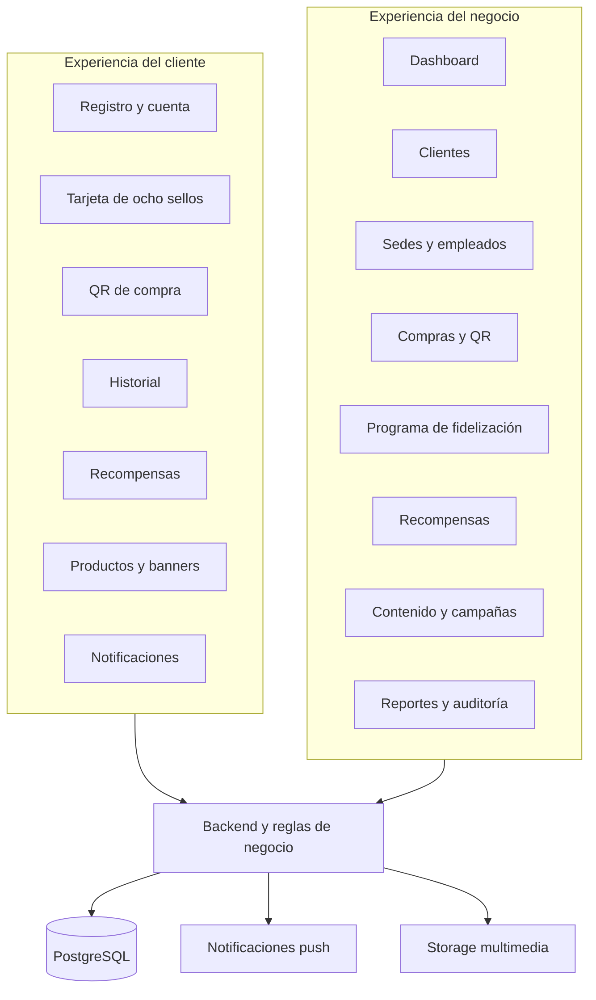

## 29.2. Arquitectura técnica

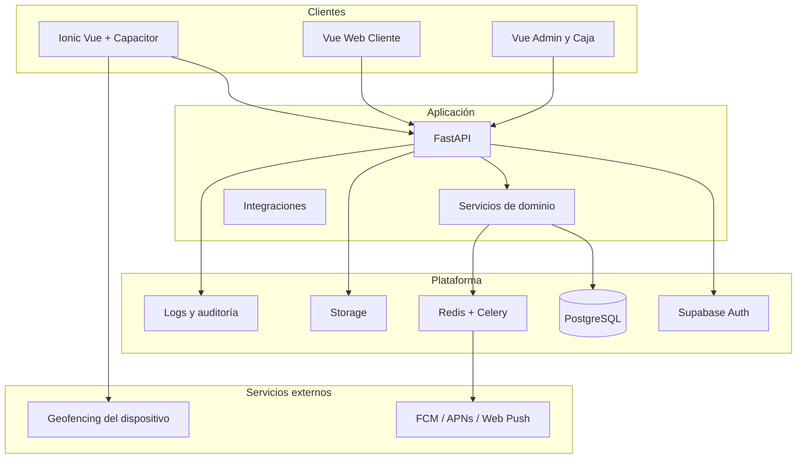

## 29.3. Flujo de compra

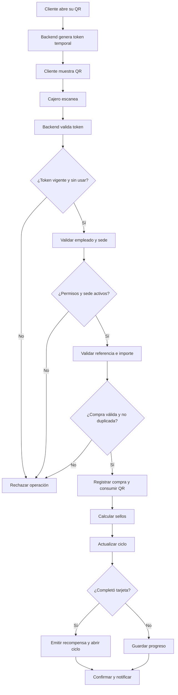

## 29.4. Ciclo de vida de tarjeta y recompensa

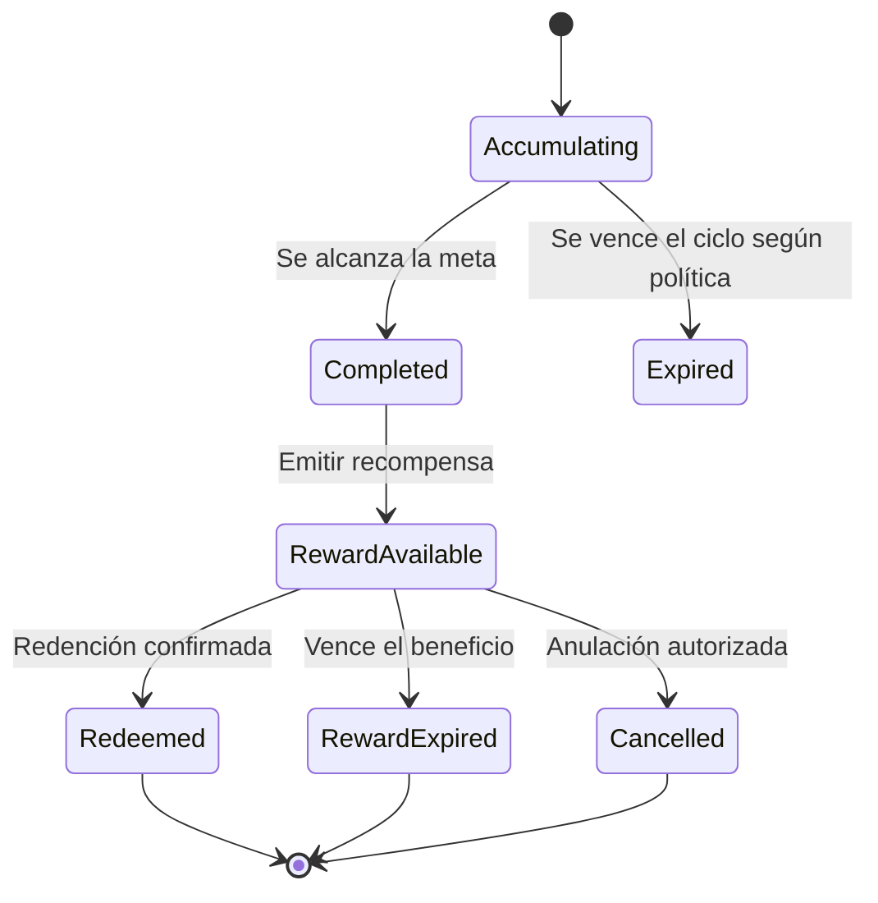

## 29.5. Secuencia de redención

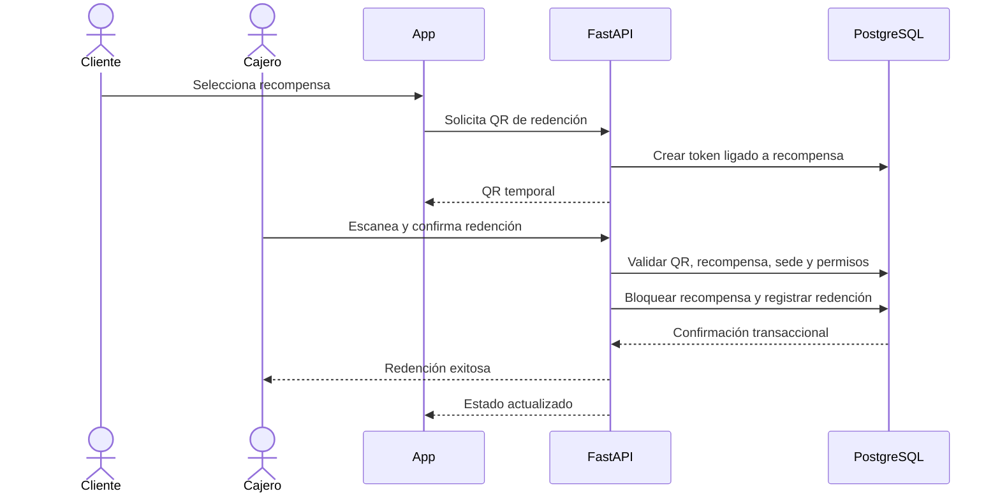

## 29.6. Flujo de notificación programada

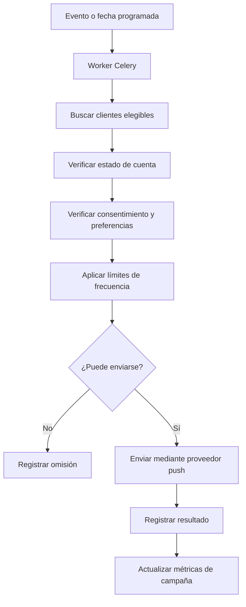

## 29.7. Mapa de roles

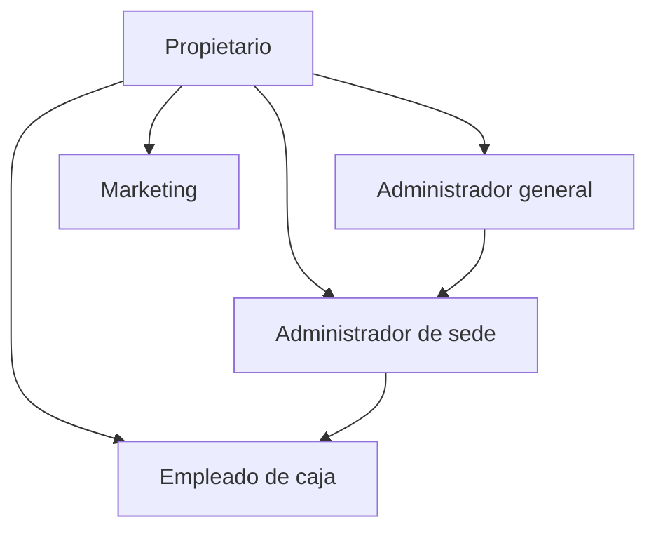

Este diagrama representa una jerarquía conceptual. Los permisos reales deben modelarse con roles y asignaciones explícitas; no se debe asumir que un rol hereda automáticamente todos los permisos del nivel superior.

## 29.8. Mapa del plan de desarrollo

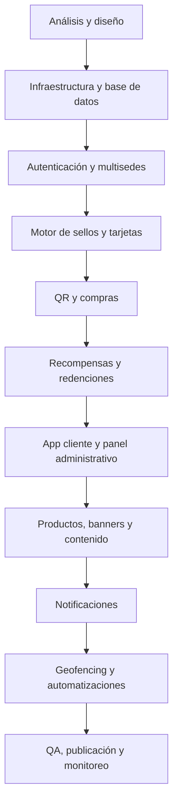

---

# Cierre y línea base para programación

La plataforma queda conceptualizada como un sistema de fidelización multisedes con una tarjeta de ocho sellos, acumulación combinada por compra e importe, recompensas configurables, identificación mediante QR dinámico, interfaces web y móviles, administración centralizada y comunicación con el cliente.

La programación debe comenzar por el modelo de datos, las reglas transaccionales y la autorización multisedes. Las interfaces deben consumir las operaciones ya definidas por el backend. El QR, las compras, los movimientos de sellos y las redenciones requieren transacciones, idempotencia, restricciones de base de datos y auditoría.

Antes de producción es indispensable aprobar los parámetros comerciales pendientes, revisar el tratamiento de datos con el responsable del negocio, seleccionar infraestructura, validar las políticas de las tiendas de aplicaciones y ejecutar pruebas integrales.

**Este documento debe tratarse como la línea base de análisis y especificación versión 1.0.** Los cambios futuros deberán registrarse mediante nuevas versiones, indicando qué regla, endpoint, tabla, pantalla o requisito se modificó y por qué.
