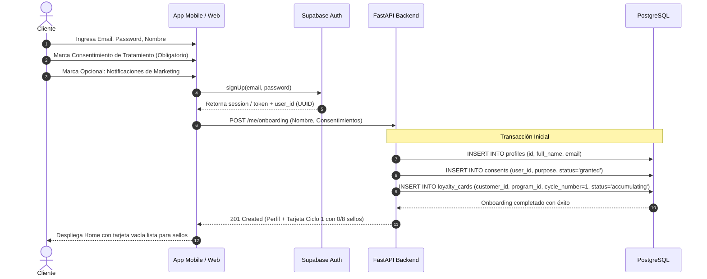
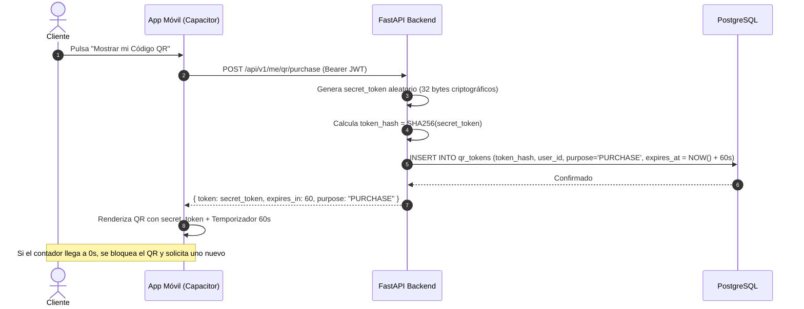
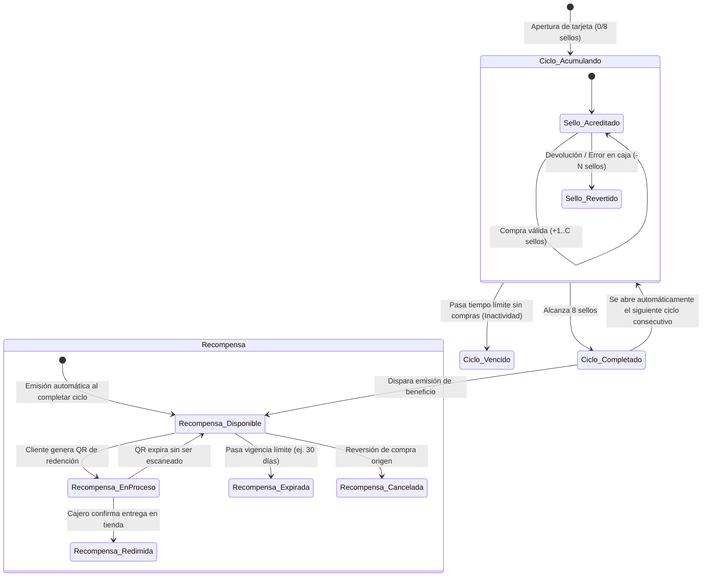
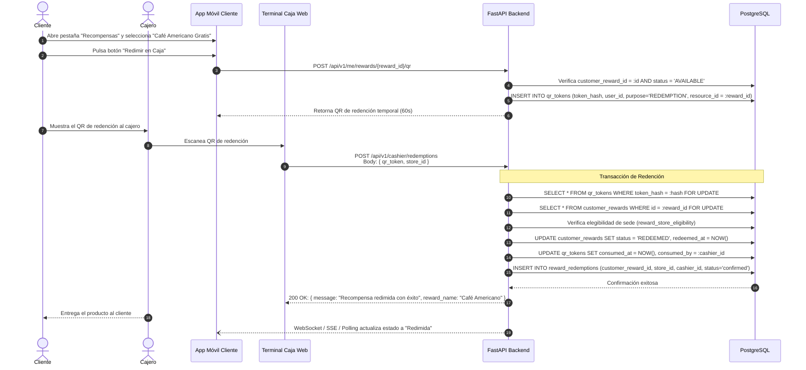
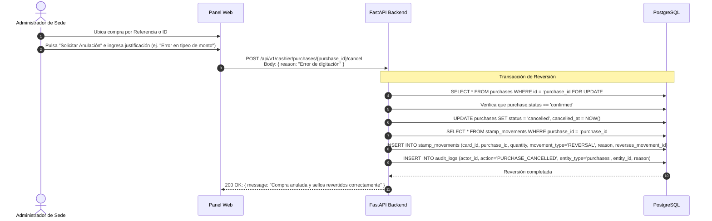
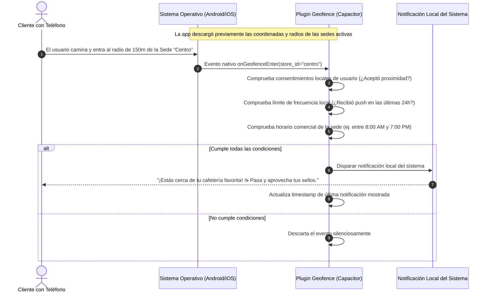

# Flujos Detallados del Sistema y Diagramas de Secuencia

**Proyecto:** Plataforma de Fidelización Multisede para Cafeterías (ConfyTickets)  
**Versión:** 1.0  
**Fecha:** Noviembre 2026  

---

## 1. Flujo 01: Registro, Autenticación y Onboarding del Cliente

Este flujo describe la incorporación del usuario a la plataforma, cumpliendo con la separación obligatoria de consentimientos según la Ley 1581 de 2012.



---

## 2. Flujo 02: Generación y Validación de QR Dinámico (Purchase & Redemption)

El código QR dinámico previene la suplantación o fraude por capturas de pantalla, utilizando tokens opacos de un solo uso con expiración a los 60 segundos.



---

## 3. Flujo 03: Registro de Compra en Caja y Acumulación de Sellos con Arrastre (Carry-Over)

Este es el flujo nuclear del negocio. Demuestra cómo se procesa una compra en caja, cómo se bloquea la tarjeta para evitar condiciones de carrera y cómo se realiza el arrastre cuando una compra supera la meta de 8 sellos.

```mermaid
sequenceDiagram
    autonumber
    actor C as Cliente
    actor K as Cajero
    participant POS as Panel Caja (Web)
    participant API as FastAPI Backend
    participant DB as PostgreSQL
    participant FCM as Firebase Cloud Messaging

    C->>K: Presenta su QR dinámico en pantalla
    K->>POS: Escanea QR con cámara/lector
    K->>POS: Ingresa Referencia Factura (ej. FAC-1024) e Importe ($30.000 COP)
    POS->>API: POST /api/v1/cashier/purchases<br/>Header: Idempotency-Key: <UUID><br/>Body: { qr_token, store_id, receipt_reference, gross_amount: 30000, discount_amount: 0 }
    
    Note over API,DB: INICIO DE TRANSACCIÓN ATÓMICA (SERIALIZABLE O ROW LOCK)
    API->>API: Calcula SHA256(qr_token)
    API->>DB: SELECT * FROM qr_tokens WHERE token_hash = :hash FOR UPDATE
    Note over API,DB: Valida: exists, consumed_at IS NULL, expires_at > NOW()
    
    API->>DB: UPDATE qr_tokens SET consumed_at = NOW(), consumed_by = :cashier_id
    API->>DB: Valida cajero asignado a store_id
    API->>DB: INSERT INTO purchases (...)
    
    API->>DB: SELECT * FROM loyalty_cards WHERE customer_id = :cid AND status = 'accumulating' FOR UPDATE
    API->>API: Aplica Fórmula: V=30000, M=10000, T=10000, C=3 => S = 3 sellos ganados
    
    alt Caso Normal: Sellos caben en la tarjeta actual (ej. tenía 3, suma 3 => 6/8)
        API->>DB: INSERT INTO stamp_movements (card_id, purchase_id, quantity=3, movement_type='EARN')
        Note over API,DB: Tarjeta queda con 6/8
    else Caso Arrastre (Carry-over): Tenía 7 sellos, suma 3 sellos (Total 10)
        API->>DB: INSERT INTO stamp_movements (card_id=ciclo1, purchase_id, quantity=1, movement_type='EARN')
        API->>DB: UPDATE loyalty_cards SET status='completed', completed_at=NOW() WHERE id=ciclo1
        API->>DB: INSERT INTO customer_rewards (customer_id, card_id=ciclo1, status='AVAILABLE', expires_at = NOW()+30d)
        API->>DB: INSERT INTO loyalty_cards (customer_id, cycle_number=2, status='accumulating')
        API->>DB: INSERT INTO stamp_movements (card_id=ciclo2, purchase_id, quantity=2, movement_type='CARRY_IN')
        Note over API,DB: Ciclo 1 completado con premio emitido; Ciclo 2 abierto con 2/8 sellos
    end
    
    Note over API,DB: COMMIT DE LA TRANSACCIÓN
    DB-->>API: Transacción Exitosa
    
    API-->>POS: 200 OK: { purchase_id, stamps_awarded: 3, current_card: { stamps: 2, required: 8 }, rewards_issued: 1 }
    K-->>C: "¡Compra registrada! Ganaste 3 sellos y obtuviste una nueva recompensa."
    
    API--)FCM: Encola notificación push transaccional para el cliente
    FCM--)C: Notificación Push: "¡Completaste tu tarjeta! Tienes un café gratis esperándote ☕"
```

---

## 4. Flujo 04: Ciclo de Vida de Tarjeta y Recompensa (State Machine)

Diagrama de estados que modela el comportamiento de las tarjetas digitales y las instancias de recompensas otorgadas al cliente.



---

## 5. Flujo 05: Redención de Recompensas en Tienda

Secuencia de operaciones para canjear un beneficio acumulado en caja física.



---

## 6. Flujo 06: Devolución de Compra y Reversión de Sellos

Manejo seguro de incidencias cuando una compra registrada debe anularse sin romper la consistencia del historial.



---

## 7. Flujo 07: Notificaciones de Proximidad por Geofencing (Nativo en Dispositivo)

Garantiza la privacidad del cliente al procesar la entrada a la geocerca de forma local en el dispositivo del usuario, sin enviar un rastreo de GPS continuo a los servidores.


