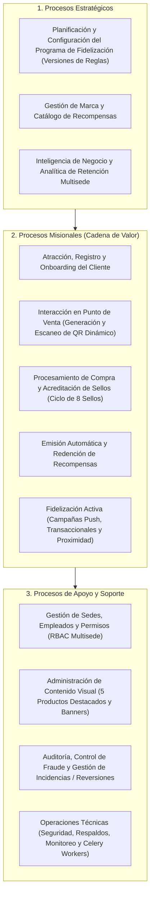

# Mapa de Procesos del Negocio

**Proyecto:** Plataforma de Fidelización Multisede para Cafeterías (ConfyTickets)  
**Versión:** 1.0  
**Fecha:** Noviembre 2026  

---

## 1. Visión General del Mapa de Procesos

La plataforma de fidelización organiza las operaciones del negocio en tres grandes niveles jerárquicos: **Procesos Estratégicos**, **Procesos Misionales (Operativos)** y **Procesos de Soporte (Apoyo)**, orientados a maximizar la recurrencia de visitas de clientes y garantizar la transparencia operativa en todas las sedes físicas.

---

## 2. Detalle de Procesos Estratégicos

### PE-01: Configuración y Versionado del Programa
- **Objetivo:** Definir las reglas matemáticas y comerciales de fidelización sin romper la consistencia de tarjetas preexistentes.
- **Entradas:** Metas comerciales de la cafetería, ticket promedio, margen de ganancia de productos.
- **Actividades:**
  1. Definir meta de sellos por ciclo (base: 8 sellos).
  2. Establecer importe mínimo elegible ($M$) y valor por sello ($T$).
  3. Fijar topes por compra ($C$) y vigencias temporales.
  4. Generar versión de regla inmutable (`loyalty_program_versions`).
- **Salidas:** Versión activa del programa lista para el cálculo en backend.

### PE-02: Gestión del Portafolio de Recompensas
- **Objetivo:** Diseñar recompensas atractivas para los clientes que completen la tarjeta de 8 sellos.
- **Actividades:** Definición de productos de cortesía, descuentos porcentuales o promociones de temporada; asignación de sedes participantes donde cada recompensa puede ser reclamada.

### PE-03: Inteligencia de Retención y Analítica Multisede
- **Objetivo:** Analizar el comportamiento del consumidor y la afluencia comparativa entre sedes.
- **Actividades:** Monitoreo de sellos emitidos vs. redimidos, cohortes de recurrencia, tasas de abandono de tarjetas, rendimiento por sede física.

---

## 3. Detalle de Procesos Misionales (Operativos)

### PM-01: Registro y Onboarding del Cliente
- **Responsables:** Cliente, Servicio Supabase Auth, Backend FastAPI.
- **Flujo:** Creación de perfil, verificación de correo electrónico, otorgamiento explícito de consentimiento de datos (Ley 1581), apertura de la primera tarjeta digital de 8 sellos vacía (0/8).

### PM-02: Interacción y Facturación en Caja (QR Dinámico)
- **Responsables:** Cliente, Cajero, Sistema Web/App.
- **Flujo:**
  1. El cliente genera un QR dinámico temporal (60 segundos de vigencia).
  2. El cajero escanea el código en la pantalla del terminal de caja.
  3. El cajero ingresa el número de recibo/factura e importe pagado.

### PM-03: Procesamiento y Acumulación de Sellos
- **Responsables:** Motor Transaccional de FastAPI y PostgreSQL.
- **Flujo:**
  1. Validación de reglas de negocio en base de datos (`SELECT ... FOR UPDATE`).
  2. Cálculo del número de sellos generados.
  3. Inserción de movimientos de sellos (`stamp_movements`).
  4. Evaluación de meta (¿Llegó a 8 sellos?).
  5. En caso de superavit (ej. tenía 7 y gana 3), cierre de tarjeta actual y apertura de nuevo ciclo con arrastre de 2 sellos.

### PM-04: Emisión y Redención de Beneficios
- **Responsables:** Cliente, Cajero, Motor de Recompensas.
- **Flujo:** Emisión del bono digital, generación de QR específico de redención por parte del cliente, validación en caja por sede habilitada y consumo del beneficio.

### PM-05: Comunicación y Engagement
- **Responsables:** Celery Workers, Redis, Firebase Cloud Messaging.
- **Flujo:** Push transaccional tras cada compra, recordatorio de tarjeta por completar, aviso de recompensa próxima a vencer, notificación local de proximidad (geocerca).

---

## 4. Detalle de Procesos de Soporte

### PS-01: Gestión de Sedes y Personal Multisede
- Creación de sucursales físicas con geolocalización y asignación granular de cajeros y administradores por sede.

### PS-02: Gestión de Vitrina y Publicidad
- Publicación de hasta 5 productos insignia en vitrina móvil y banners promocionales rotativos.

### PS-03: Control de Fraude, Reversiones y Auditoría
- Trazabilidad forense de cada movimiento, gestión de devoluciones con anulación de sellos otorgados erróneamente y resolución de disputas de clientes.
