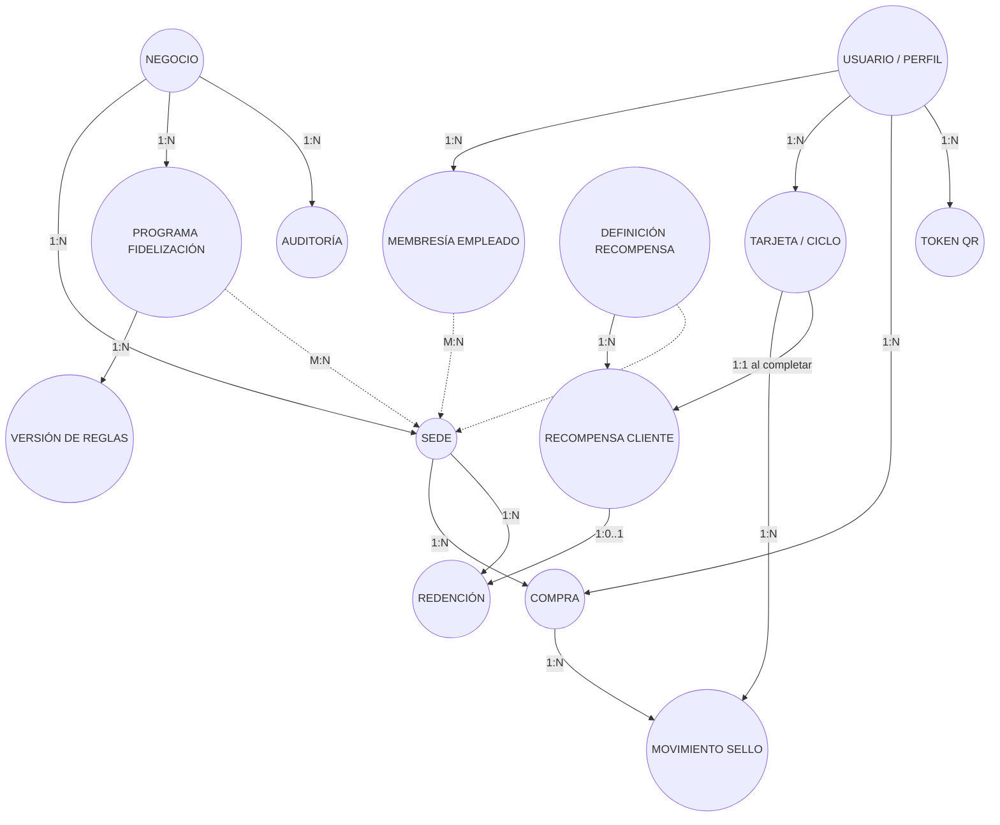

# Modelo Entidad-Relación Conceptual (MER)

**Proyecto:** Plataforma de Fidelización Multisede para Cafeterías (ConfyTickets)  
**Versión:** 1.0  
**Fecha:** Noviembre 2026  

---

## 1. Definición de Entidades del Negocio

El modelo conceptual captura las entidades del mundo real que intervienen en la plataforma de fidelización:

1. **NEGOCIO (Business):** Representa la marca o empresa propietaria de la cadena de cafeterías.
2. **SEDE (Store):** Sucursal o punto de venta físico donde los clientes realizan consumos y canjes.
3. **USUARIO / PERFIL (Profile):** Persona que interactúa con el sistema (puede ser cliente o empleado).
4. **MEMBRESÍA DE EMPLEADO (Business Membership):** Vinculación formal de un usuario con un negocio, definiendo su rol operativo (`OWNER`, `GENERAL_ADMIN`, `STORE_ADMIN`, `CASHIER`, `MARKETING`).
5. **PROGRAMA DE FIDELIZACIÓN (Loyalty Program):** Esquema de acumulación y fidelidad de la marca.
6. **VERSIÓN DE REGLA (Program Version):** Conjunto parametrizado e inmutable de reglas de acumulación y vencimiento vigentes en un periodo de tiempo.
7. **TARJETA DIGITAL / CICLO (Loyalty Card):** Instancia de seguimiento de fidelización de un cliente individual hacia una meta definida de sellos (meta base: 8 sellos).
8. **COMPRA (Purchase):** Transacción económica realizada por un cliente en una sede física, respaldada por un comprobante de caja.
9. **MOVIMIENTO DE SELLO (Stamp Movement):** Cada variación auditable de sellos en una tarjeta (ganancia, reversión por anulación, vencimiento, arrastre).
10. **TOKEN QR (QR Token):** Credencial criptográfica temporal y de un solo uso generada para identificar al cliente o autorizar un canje.
11. **DEFINICIÓN DE RECOMPENSA (Reward Definition):** Beneficio parametrizado ofrecido en el catálogo de la cafetería.
12. **RECOMPENSA DE CLIENTE (Customer Reward):** Derecho o cupón individual otorgado a un cliente específico tras completar una tarjeta.
13. **REDENCIÓN (Reward Redemption):** Acto en el cual el cliente hace efectivo su premio en una sede autorizada frente a un cajero.
14. **PRODUCTO DESTACADO (Product):** Ítem del menú de la cafetería expuesto en la vitrina digital de la aplicación (hasta 5 productos).
15. **BANNER PROMOCIONAL (Banner):** Pieza gráfica de comunicación visual que se muestra en el home de la app.
16. **CAMPAÑA DE NOTIFICACIÓN (Notification Campaign):** Mensaje masivo o segmentado programado para incentivar visitas.
17. **DISPOSITIVO PUSH (Push Device):** Teléfono o navegador vinculado a un usuario para recibir notificaciones a través de FCM/APNs.
18. **CONSENTIMIENTO (Consent):** Registro probatorio de la autorización otorgada por el cliente para el tratamiento de datos y marketing bajo la Ley 1581 de 2012.
19. **REGISTRO DE AUDITORÍA (Audit Log):** Bitácora inmutable de eventos sensibles, modificaciones administrativas y cancelaciones.

---

## 2. Matriz de Relaciones y Cardinalidades

| Entidad Origen | Cardinalidad | Relación Conceptual | Entidad Destino | Cardinalidad | Descripción de Negocio |
|---|:---:|---|---|:---:|---|
| **NEGOCIO** | 1 | posee / opera | **SEDE** | N | Un negocio opera múltiples sucursales físicas. |
| **NEGOCIO** | 1 | define | **PROGRAMA** | N | Un negocio crea programas de fidelización. |
| **PROGRAMA** | 1 | evoluciona en | **VERSIÓN DE REGLA** | N | Un programa tiene versiones históricas de sus parámetros. |
| **PROGRAMA** | N | aplica en | **SEDE** | M | Varias sedes participan en un programa multisede (`program_stores`). |
| **USUARIO** | 1 | desempeña | **MEMBRESÍA** | N | Un empleado tiene un rol dentro del negocio. |
| **MEMBRESÍA** | N | está autorizado en | **SEDE** | M | Un cajero/admin puede operar en una o varias sedes asignadas. |
| **USUARIO** | 1 | posee | **TARJETA DIGITAL** | N | Un cliente acumula sellos a través de sucesivos ciclos de tarjetas. |
| **PROGRAMA** | 1 | norma | **TARJETA DIGITAL** | N | Cada tarjeta se rige por las reglas del programa. |
| **TARJETA DIGITAL**| 1 | registra | **MOVIMIENTO SELLO**| N | Una tarjeta registra cada sello ganado, expirado o revertido. |
| **COMPRA** | 1 | origina | **MOVIMIENTO SELLO**| N | Una compra aprobada acredita uno o varios sellos. |
| **SEDE** | 1 | registra | **COMPRA** | N | Cada compra ocurre físicamente en una sede. |
| **USUARIO** | 1 | genera | **TOKEN QR** | N | El cliente genera códigos QR temporales para compra o redención. |
| **NEGOCIO** | 1 | cataloga | **DEFINICIÓN RECOMP.**| N | El negocio define el menú de beneficios disponibles. |
| **DEFINICIÓN RECOMP.**| N | es canjeable en | **SEDE** | M | Sedes autorizadas para entregar cada tipo de premio. |
| **DEFINICIÓN RECOMP.**| 1 | instancia | **RECOMPENSA CLIENTE**| N | Al completar 8 sellos se crea un cupón para el cliente. |
| **TARJETA DIGITAL**| 1 | genera al completar | **RECOMPENSA CLIENTE**| 1 | La tarjeta completada da origen a un beneficio individual. |
| **RECOMPENSA CLIENTE**| 1 | se consume mediante| **REDENCIÓN** | 0..1 | Cada premio solo puede ser redimido una única vez en caja. |
| **SEDE** | 1 | valida | **REDENCIÓN** | N | La redención física ocurre en una sede autorizada. |
| **NEGOCIO** | 1 | exhibe | **PRODUCTO** | N | Catálogo de productos con límite de 5 destacados. |
| **NEGOCIO** | 1 | publica | **BANNER** | N | Banners de comunicación activos por fechas. |
| **USUARIO** | 1 | registra | **DISPOSITIVO PUSH**| N | Un cliente puede tener la app en teléfono Android e iOS. |
| **USUARIO** | 1 | concede | **CONSENTIMIENTO** | N | Registro de autorización de tratamiento de datos personales. |
| **NEGOCIO** | 1 | audita | **REGISTRO AUDITORÍA**| N | Trazabilidad forense de operaciones en el negocio. |

---

## 3. Diagrama MER Conceptual

