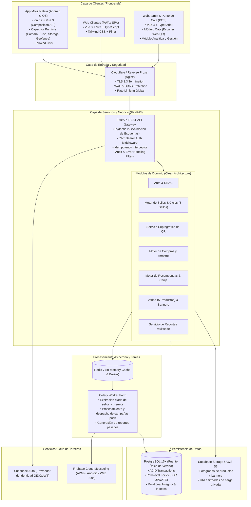

# Arquitectura Técnica de Software e Infraestructura

**Proyecto:** Plataforma de Fidelización Multisede para Cafeterías (ConfyTickets)  
**Versión:** 1.0  
**Fecha:** Noviembre 2026  

---

## 1. Topología General de Arquitectura

El sistema se compone de cuatro canales front-end desacoplados que consumen una única API REST centralizada construida con FastAPI, garantizando que ninguna regla comercial, cálculo de sellos o validación de canje se ejecute del lado cliente.

---

## 2. Responsabilidades por Componente

### 2.1. Aplicación Móvil (Android & iOS)
- **Tecnología:** Ionic Framework v7 + Vue 3 + Capacitor v6.
- **Responsabilidad:** Presentación fluida, despliegue del QR dinámico de compra y redención, renderizado de la tarjeta de 8 sellos con animaciones sutiles, recepción de notificaciones push transaccionales y detección de geocercas locales (proximidad).
- **Seguridad:** Los tokens de autenticación se almacenan mediante `@capacitor/preferences` o Secure Storage nativo (Keystore en Android, Keychain en iOS).

### 2.2. Web de Clientes
- **Tecnología:** Vue 3 (Composition API) + Vite + Pinia + Tailwind CSS.
- **Responsabilidad:** Permitir que usuarios que ingresen desde un navegador de escritorio o móvil consulten su progreso, recompensas, productos destacados y editen sus preferencias de privacidad sin obligarlos a instalar la app de inmediato.

### 2.3. Panel Web de Administración y Punto de Caja (POS)
- **Tecnología:** Vue 3 + Tailwind CSS + VueUse.
- **Submódulo Caja:** Vista optimizada de alto contraste para terminales de caja, con escaneo rápido de QR usando la cámara o lector de código de barras 2D, e ingreso ágil de número de recibo e importe.
- **Submódulo Gestión:** Dashboards de indicadores, control de sedes, autorización de cajeros, publicación de los 5 productos destacados, banners y auditoría.

### 2.4. Backend Central (FastAPI)
- **Tecnología:** Python 3.11+ / FastAPI / SQLAlchemy 2.0 (Async) / Alembic / Pydantic v2.
- **Responsabilidad:**
  - Validar JWT contra las claves públicas JWKS de Supabase Auth.
  - Implementar RBAC granular con verificación de sedes autorizadas.
  - Ejecutar en una sola transacción atómica el consumo del QR, el registro de compra, el cálculo de sellos y el arrastre (*carry-over*) al ciclo consecutivo si se completan los 8 sellos.
  - Control estricto de idempotencia (`Idempotency-Key`).

### 2.5. Base de Datos (PostgreSQL)
- **Responsabilidad:** Mantener la integridad referencial y ACID. Bloqueo de fila (`SELECT ... FOR UPDATE`) sobre la tarjeta de fidelización para evitar condiciones de carrera si dos cajas procesan compras para el mismo cliente simultáneamente.

### 2.6. Cola de Tareas Asíncronas (Redis + Celery)
- **Responsabilidad:**
  - `beat_expire_stamps`: Tarea programada diaria que evalúa sellos expirados.
  - `beat_expire_rewards`: Tarea programada diaria que marca como `EXPIRED` los premios no canjeados en el plazo fijado (ej. 30 días).
  - `task_send_campaign`: Envío segmentado en lotes hacia FCM respetando los límites de frecuencia de marketing (máx. 1 al día, máx. 3 a la semana).
